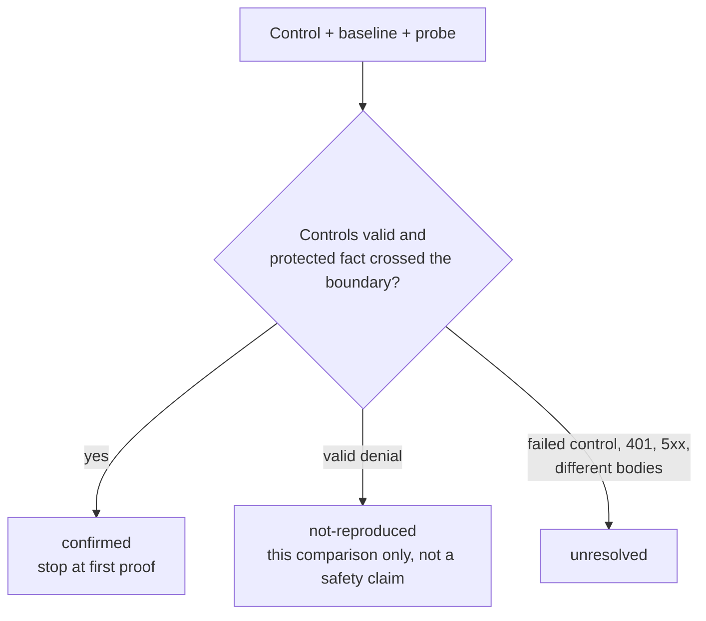
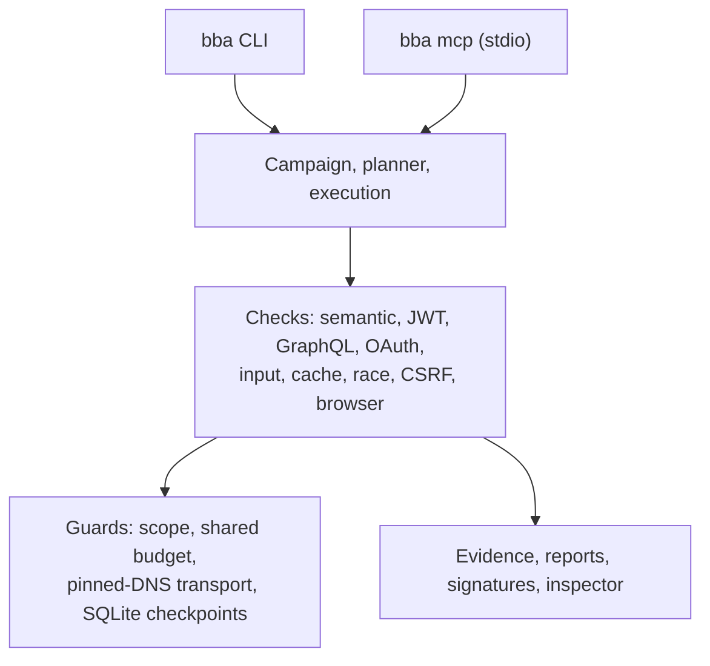

<div align="center">

**English** · [Español](docs/readme/README_es.md) · [Português (Brasil)](docs/readme/README_pt-BR.md) · [简体中文](docs/readme/README_zh.md)

# BBA: Bug Bounty Anything

### A local agent skill and CLI/MCP engine for authorized vulnerability research, with verifiable evidence.

**Point your agent at an authorized service. Get scoped checks, reproducible proof, and a report draft you review.**

[](https://www.npmjs.com/package/bug-bounty-anything)
[](.github/workflows/ci.yml)
[](#requirements)
[](docs/installation.md#installation-diagnosis-and-mcp)
[](LICENSE)

[Quick start](#quick-start) · [How BBA works](#how-bba-works) · [What you can check](#what-you-can-check) · [Examples](#examples) · [FAQ](#faq) · [Documentation](#documentation)

<code>npx --yes bug-bounty-anything@latest capabilities</code>

</div>

> [!IMPORTANT]
> Get BBA from [matiasdante/bug-bounty-anything](https://github.com/matiasdante/bug-bounty-anything)
> or the [bug-bounty-anything npm package](https://www.npmjs.com/package/bug-bounty-anything).
> A similar repository name or a copied README does not establish that a download is official.
> BBA is for services you are authorized to test. Read the [disclosure notice](DISCLOSURE) first.

---

For an authorized service, your agent establishes scope and program policy, prepares a case, projects the attack surface, runs bounded comparisons with accounts you control, and drafts a report. Every conclusion carries its evidence and its limits. BBA never sends a report on its own.

It is not a general scanner. The agent drives the investigation; the local engine supplies bounded HTTP and Chromium checks, offline importers, persistent evidence, and checks for authorization, input, cache, race, and browser behavior. Not finding a confirmed vulnerability is a valid result, and coverage is never claimed beyond what ran.

Version `2.0.0` unifies CLI and MCP commands, supports Node.js `>=22.13.0` and `--lang es|en`, and adds the checks listed [below](#what-you-can-check). The [roadmap](docs/ROADMAP.md) records coverage and limits.

## Quick start

### Requirements

- Node.js **22.13.0 or newer**, with npm. Node provides native SQLite. The only production dependency is `playwright-core` (Apache-2.0).
- Chromium, only for capture and browser checks: `npx playwright-core install --only-shell chromium`.
- Loopback access to `127.0.0.1` for the local labs and the inspector.

### Set up your agent

```bash
npm install --global bug-bounty-anything@latest
bba install-skill --out ~/.agents/skills/bug-bounty-anything
bba doctor
```

On PowerShell use `"$env:USERPROFILE/.agents/skills/bug-bounty-anything"`. The output directory must be new. Start a new chat if your agent has not refreshed its skill catalog. Keep the package where it is installed: `runtime.json` points to its Node runtime and compiled CLI.

For Claude Code, Codex, or Gemini CLI you can also build a portable ZIP with `npm run package:skill -- --out dist-skill.zip` and unpack `bug-bounty-anything` into `.claude/skills/` or `~/.claude/skills/`. To register the optional MCP server, preview with `bba setup-mcp --root <workspace> --client claude`, then add `--apply`. See [installation and setup](docs/installation.md).

### Ask your agent

```text
$bug-bounty-anything investigate https://authorized-service/ and prepare findings
```

The agent looks up the current program policy and creates the files it needs. It asks only for facts it cannot establish itself, such as test accounts or an access rule. Without authorization it stops active checks on that asset; public research may continue.

### Use the terminal

Try the engine on a disposable local lab. It starts a server on `127.0.0.1`, creates two synthetic accounts, and shuts down when done:

```bash
npx --yes bug-bounty-anything@latest lab --variant vulnerable --out runs/vulnerable
npx --yes bug-bounty-anything@latest lab --variant fixed --out runs/fixed
```

Then work on an authorized service with a scope file:

```bash
bba prepare --scope scope.json --target https://authorized-service/ --out runs/investigation
bba investigate --scope scope.json --surface surface.json --profile profile.json --out runs/investigation
bba export-submission runs/investigation --platform hackerone --out runs/h1-draft.md
```

If policy or an authorization window is missing, `bba start-case --target <url> --out <directory>` records a pending case without creating a scope or sending requests. See the [CLI guide](docs/cli.md) for every command.

### Update BBA

```bash
npm install --global bug-bounty-anything@latest
bba update-skill --out ~/.agents/skills/bug-bounty-anything
```

`update-skill` updates managed files, keeps a backup in `.bba-backups/`, rejects resource links, and preserves unrelated files. An interrupted update is never reported as complete.

## How BBA works

The agent resolves the target and the program's current policy, then writes a scope that every later request must satisfy. Checks run through BBA's own transport, which enforces that scope and a shared budget. Results are stored as redacted, hash-chained evidence, and the report is a draft for you.

```mermaid
flowchart LR
    U["You: investigate<br/>an authorized service"] --> A["Agent + BBA skill"]
    A --> P["1. Resolve target,<br/>read current policy"]
    P --> S["2. scope.json<br/>assets, window, limits"]
    S --> D["3. Discover surface<br/>capture, HAR, OpenAPI,<br/>REA, GraphQL, JS"]
    D --> H["4. Choose hypotheses<br/>profile with your own accounts"]
    H --> C["5. Bounded checks<br/>scope + budget + pinned transport"]
    C --> E["6. Evidence<br/>SQLite checkpoints,<br/>redacted facts, hashes"]
    E --> R["7. Draft report<br/>you review and submit"]
```



Each check compares an anonymous control, a baseline, and a probe, and reports one of three outcomes:



The diagram below shows the engine's layers. Open the [architecture source](docs/architecture.mermaid) for the module map.



## What you can check

Every row needs authorized paths and methods, resources you control, and negative controls. A documented class is not automatically a detector.

| Check                              | What BBA returns                                                                              | Requirements and guide                                                                                   |
| ---------------------------------- | --------------------------------------------------------------------------------------------- | -------------------------------------------------------------------------------------------------------- |
| BOLA, BFLA, property exposure      | Outcome from server-supplied identities, protected facts, and anonymous/baseline/probe controls | Scope, profile, two controlled accounts; [investigation](docs/INVESTIGATION.md)                          |
| Tenant isolation, mass assignment  | Same, with before/after state on disposable resources                                         | Declared business rules; [investigation](docs/INVESTIGATION.md)                                          |
| Autonomous BOLA hunt               | Discovered HTML resources checked across two accounts                                         | Current scope and identity/ownership rules; [hunt](docs/HUNT.md)                                         |
| GraphQL authorization              | Per-operation authorization comparison                                                        | GraphQL introspection or SDL import; [CLI guide](docs/cli.md)                                            |
| JWT integrity                      | Whether altered claims, `alg-none`, or expired tokens are still accepted                      | A token from an account you own; [JWT integrity](docs/JWT-INTEGRITY.md)                                  |
| OAuth `redirect_uri`, redirects    | 3xx `Location` classification, never followed, no codes retained                              | Scoped authorization route; [CLI guide](docs/cli.md)                                                     |
| XSS and CORS                       | Marker execution and actual cross-origin reads in Chromium                                    | Chromium; [browser checks](docs/BROWSER-CHECKS.md)                                                       |
| Browser workflows                  | Declared navigation, form, and cookie-rotation scenarios in an ephemeral context              | Chromium; [scenarios](docs/SCENARIOS.md)                                                                 |
| Template expression, URL callback  | Evaluation of `a*b` syntax; outbound request to a receiver you own                            | Exact scope rules; [input proofs](docs/INPUT-PROOFS.md)                                                  |
| Cache, race, CSRF                  | Cache-correlated exposure, single-use double spend, cross-origin form against owned state     | Owned resources; [cache](docs/CACHE-CHECK.md), [race](docs/RACE-CHECK.md), [CSRF](docs/CSRF-CHECK.md)   |
| Surface import (offline)           | Endpoints from HAR 1.2, OpenAPI/Swagger, REA evidence, GraphQL, JS bundles and SourceMap      | None; `import-surface`; [CLI guide](docs/cli.md#import-surface-and-policy)                               |
| Policy and scanner import (offline) | HackerOne, Bugcrowd, Intigriti, `security.txt`; ZAP, Nuclei, Subfinder results, always `unvalidated` | None; BBA never runs these scanners; [CLI guide](docs/cli.md)                                      |
| Published case studies             | A published bug class replayed as one bounded candidate                                       | Current policy and owned account; [case studies](docs/PUBLISHED-CASE-STUDIES.md)                         |
| Evidence and reports               | Redacted facts, Ed25519 signatures, submission drafts, read-only inspector                    | None; [CLI guide](docs/cli.md#signatures-submission-drafts-and-local-inspector)                          |

Run `bba capabilities` for the authoritative list of what your installed version confirms, imports only, or does not support.

## Examples

### Vulnerable and fixed lab

The lab creates two synthetic accounts and one private document each, sends five sequential GETs, and decides from responses and controls, not from the variant name.

```text
$ bba lab --variant vulnerable --out runs/vulnerable
{ "variant": "vulnerable", "requests": 5, "confirmed": 2, "notReproduced": 0, "unresolved": 0 }

$ bba lab --variant fixed --out runs/fixed
{ "variant": "fixed", "requests": 5, "confirmed": 0, "notReproduced": 2, "unresolved": 0 }
```

| Request                       | Vulnerable             | Fixed |
| ----------------------------- | ---------------------- | ----- |
| Anonymous reads document B    | 401                    | 401   |
| A reads document A            | 200                    | 200   |
| B reads document B            | 200                    | 200   |
| A reads document B            | 200 and B's content    | 403   |
| B reads document A            | 200 and A's content    | 403   |

`inspect` and `report` read the saved evidence offline. The vulnerable variant shows two directions of one root cause, not two independent vulnerabilities, and no production severity is inferred.

```bash
bba inspect runs/vulnerable
bba report runs/vulnerable --out runs/vulnerable-export.md
```

### JWT signature integrity on your own account

Four requests to one endpoint: anonymous, original token, token with a changed claim and the old signature, original token again. `confirmed` needs anonymous denial and the same owned protected fact with both tokens.

```bash
export BBA_TOKEN_OWNED='<signed JWT of your own test account>'
export BBA_BODY_QUERY='{"query":"SELECT 1","tableName":"OwnedTestData","rowLimit":1}'
bba jwt-check --scope scope.json --config jwt-check.json --out runs/jwt-check
```

[Read the contract](docs/JWT-INTEGRITY.md) · [Published case studies](docs/PUBLISHED-CASE-STUDIES.md)

### Campaign case for one target

Open a case, link scope and policy review, capture or import the surface, link a profile with two controlled identities, then execute once under a shared budget. Interrupted work resumes without repeating recorded steps.

```bash
bba campaign-open --target https://authorized-service/ --out runs/case
bba campaign-status runs/case
bba campaign-execute runs/case
```

[Read the campaign guide](docs/CAMPAIGNS.md) · [Execution core](docs/EXECUTION.md)

## FAQ

<details>
<summary><strong>Which agents can use BBA?</strong></summary>

Any agent that loads skills from a folder: Claude Code, Codex, and Gemini CLI are covered by the installer and packager. The optional MCP server (`bba mcp`) works with clients that support local stdio servers; `setup-mcp` registers it for Codex, Claude, or Gemini.

</details>

<details>
<summary><strong>Do I need MCP?</strong></summary>

No. The skill works through the CLI. MCP registration exposes offline tools only until you pass `--allow-network`, and paths are confined to `--root`.

</details>

<details>
<summary><strong>Is BBA a vulnerability scanner?</strong></summary>

No. It does not crawl, fuzz, or run ZAP, Nuclei, or Subfinder. It imports their output offline as unvalidated candidates. Active checks are specific comparisons that need declared scope, accounts you control, and negative controls.

</details>

<details>
<summary><strong>What does it mean when a check is `confirmed`?</strong></summary>

The declared rule was violated for the exact account, route, and field tested, and the controls held. It is not a severity, a statement about other routes, or proof of impact. `not-reproduced` excludes only that comparison, and `unresolved` means the controls did not establish a result.

</details>

<details>
<summary><strong>Does BBA contact services without permission?</strong></summary>

`scope-check` validates format, window, and destination matching; it does not verify the owner's permission. The agent or you must establish permission and the current program rules before writing a scope. A policy URL, `security.txt`, or interest alone is not authorization.

</details>

<details>
<summary><strong>Does BBA upload my data or send reports?</strong></summary>

Analysis runs locally. Credentials come from environment variables and are never persisted. Your agent receives tool results, and its model provider has its own data policy. BBA never submits a report; `export-submission` writes a Markdown draft for you to review.

</details>

<details>
<summary><strong>Do I need Chromium?</strong></summary>

Only for `capture`, `browser-check`, and `browser-scenario`. Install it separately with `npx playwright-core install --only-shell chromium`. Other commands do not need it.

</details>

<details>
<summary><strong>What should I do if I hit a bug?</strong></summary>

Update first; a recent release may already fix it. Run `bba doctor`, retry, and if the problem persists, [open an issue](https://github.com/matiasdante/bug-bounty-anything/issues) with your BBA and Node versions, the command, and the error output. Never include tokens, cookies, or target data.

</details>

<details>
<summary><strong>What is not covered yet?</strong></summary>

Login/SSO and dynamic token inference, confirmation of more vulnerability classes, and confined scanner execution. Declared form/action scenarios and in-memory cookie rotation run today but cannot resume after a crash. Semantic generation and XSS/CORS checks have bounded GET coverage. See the [roadmap](docs/ROADMAP.md).

</details>

## Documentation

For exact options, prerequisites, and result contracts:

- [Installation and setup](docs/installation.md): skill, npm, diagnostics, and MCP registration.
- [CLI guide](docs/cli.md): scoped execution, imports, capture, evaluation, signatures, headers, and limits.
- [Execution core](docs/EXECUTION.md): scope and plan contracts, checkpoints, and recovery.
- [Investigation and evidence](docs/INVESTIGATION.md): semantic classes, facts, and cross-phase budget.
- [Campaigns](docs/CAMPAIGNS.md), [autonomous hunt](docs/HUNT.md), and [published case studies](docs/PUBLISHED-CASE-STUDIES.md).
- Checks: [JWT](docs/JWT-INTEGRITY.md), [browser](docs/BROWSER-CHECKS.md), [scenarios](docs/SCENARIOS.md), [input proofs](docs/INPUT-PROOFS.md), [cache](docs/CACHE-CHECK.md), [race](docs/RACE-CHECK.md), [CSRF](docs/CSRF-CHECK.md).
- [Persistent data model](docs/database.md) and [architecture map](docs/architecture.mermaid).
- [Roadmap](docs/ROADMAP.md): chronology, evidence, and remaining limits.
- Agent instructions: [SKILL.md](SKILL.md) and [references](references/).

Documentation is also available in [Español](docs/es/), [Português (Brasil)](docs/pt-BR/), and [简体中文](docs/zh/).

## Disclaimer

See [DISCLOSURE](DISCLOSURE) for responsible-use guidance.

BBA is for bug bounty research, penetration testing, and defensive validation under the asset owner's authorization and the program's current rules. Operators are responsible for obtaining authorization, respecting exclusions and rate limits, and reviewing findings before disclosure. Lab metrics do not estimate real-world detection or false-positive rates and do not prove a target safe.

## Contributing

We'd love your help with BBA! [Open an issue](https://github.com/matiasdante/bug-bounty-anything/issues) to report a bug or suggest a feature, or send a pull request.

Development setup: `npm install`, then `npm run verify` (strict TypeScript check, build, and tests). Tests use real local HTTP servers and never contact production services. CI runs on Ubuntu and Windows with Node 22.13 and 24. See the [CLI guide](docs/cli.md#verification) for exit codes.

## License

[MIT](LICENSE)
