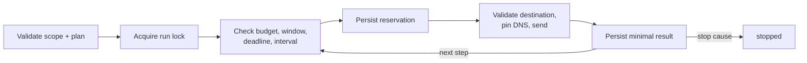
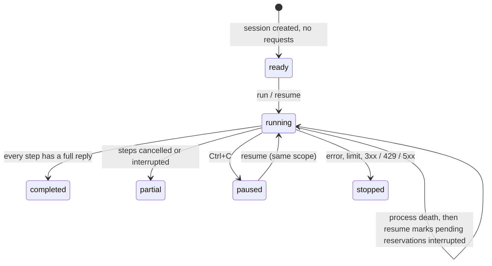

# Execution core

**English** · [Español](es/EXECUTION.md) · [Português (Brasil)](pt-BR/EXECUTION.md) · [简体中文](zh/EXECUTION.md)

This core runs finite HTTP plans under code-checked scope and persists attempts across processes. HTTP replies are observations; [semantic checks](INVESTIGATION.md) and [browser checks](BROWSER-CHECKS.md) have their own confirmation criteria. `lab` retains its previous artifact format.

## Prepare scope

[src/scope.ts](../src/scope.ts) validates the contract. `scope-check` is offline: it does not read remote policy or turn a written reference into permission. Verify actual authority, permitted techniques, and safe GET effects before execution.

| Field | Requirement |
|---|---|
| `schemaVersion` | `1` |
| `mode` | `loopback-lab`: HTTP to explicit-port `127.0.0.1`; `public-https`: HTTPS to allowed public addresses |
| `authorization` | Secret-free `reference`, UTC ISO `validFrom` / `validUntil` |
| `allowed`, `excluded` | `{ origin, paths }` with exact matching, no wildcards; exclusions win |
| `requestHeaders` | Optional per-origin `{ origin, name, valueEnv }`; lowercase `user-agent` or `x-*`, value from `BBA_HEADER_*` |
| `requestRules` | Optional exact `{ origin, path, method, queryNames, bodyFormats }` within allowed path |
| `budgetId` | Optional for older scopes; new scopes should share budget across phases next to canonical scope |
| `limits.maxRequests` | 1–100 attempts across the investigation |
| `limits.minIntervalMs` | 0–60000 ms between an attempt's end and the next start |
| `limits.timeoutMs` | 1–60000 ms including DNS and reading |
| `limits.maxResponseBytes` | 1 byte–1 MiB per response body |
| `limits.maxDurationMs` | 1 ms–24 hours since creation, including pauses |

URLs must be canonical: no queries, fragments, embedded credentials, percent escapes, normalized segments, or ambiguous paths. Never put secrets/personal data in references, IDs, or paths, which persist as metadata. The full scope is frozen by digest; even extending validity requires a new investigation. By default only GET without query/body is allowed. `requestRules` can explicitly allow GET, HEAD, OPTIONS, POST, PUT, PATCH, DELETE, selected query names, and body formats. Review each state-changing operation, use controlled resources, and plan cleanup. Redirects, path escapes, wildcards, and embedded URL queries stay blocked. An example rule is `{ "origin": "https://service.example", "path": "/api/search", "method": "POST", "queryNames": ["page"], "bodyFormats": ["json"] }`. GET/HEAD never accept bodies.

Identification `requestHeaders` are not authentication or spoofing tests. Each origin/name pair must be unique; values are 1–512 printable ASCII characters resolved before execution and discarded from evidence. Missing values, CR/LF, and auth/transport names are blocked. Browser requests follow the same origin rule. Changing references changes scope digest and cannot silently alter a resumed run. `prepare --scope scope.json --target <exact-url> --out <new-dir>` writes an offline case, scope copy, seed plan, and notes without requests or proof of authority.

## Prepare plan

`plan.json` has `schemaVersion: 1` and 1–100 ordered steps, each with ID, method, URL, and credential reference:

```json
{
  "id": "owner-control",
  "method": "GET",
  "url": "http://127.0.0.1:8787/documents/example",
  "credentialEnv": "BBA_TOKEN_ACCOUNT_A"
}
```

This is a structural example; `npm run demo:core -- --out runs/core-demo` makes a real local demonstration. Optional fields: `query: [{ name, valueEnv: "BBA_INPUT_PAGE" }]`, `body: { format: "json", valueEnv: "BBA_BODY_SEARCH" }`, `observe: [{ name: "id", pointer: "/result/id" }]`. Input values are never arguments or persisted. Queries allow up to 20 unique names, 2,048 bytes per value, and a resolved URL up to 8,192 characters. Bodies allow 64 KiB in JSON, form, or text; JSON is validated before a network reservation. Session-bound digests fix inputs at start and reject changed inputs on resume. Preserve original values in the environment; credential rotation does not permit changing inputs.

`credentialEnv` is `null` for anonymous or a `BBA_TOKEN_*` Bearer or `BBA_COOKIE_*` Cookie string (`name=value; name2=value2`). Missing or invalid values fail before reservation. Values are never stored in arguments, results, logs, or evidence; they must be available again for resume.

## Execution and network

1. Validate scope/plan, acquire exclusive run lock, check previous checkpoints.
2. Mark reservations without results `interrupted`; do not resend or refund them.
3. Check budget, authorization window, deadline, interval, and cancellation; persist reservation before sending.
4. Validate destination, resolve DNS, pin the accepted address for this connection while retaining hostname/SNI and TLS validation.
5. Persist minimal result or stop cause; continue only to the next permitted step.



Public mode rejects DNS sets containing private, loopback, or known special addresses, including mixed answers. IPv6 conservatively supports a global-unicast subset. Each connection is validated without a later transport re-resolution. Environment proxies are unused, TLS is not disabled, redirects are not followed even to scoped targets, and failures are not retried automatically. Execution is sequential with shared per-run budgets. With `budgetId`, CLI/MCP share a locked durable ledger across phases; another ledger is rejected on resume. Historical scopes remain per-run. [Cross-phase budget](INVESTIGATION.md#budget-across-phases) explains it; external tools require extra accounting.

## Checkpoints and recovery

`session.sqlite` stores versioned snapshots with sequence, previous hash, and state SHA-256; every reservation and result commits with `synchronous=FULL`. Loading verifies checkpoints, contracts, transitions, and completed evidence immutability. `execution-lock.sqlite` holds a separate transaction lock while running. The OS releases it on process death; committed checkpoints remain. No PID or lock file needs manual deletion. `.initializing` marks an incomplete directory if creation fails; choose another output.

| State | Meaning / recovery |
|---|---|
| `ready` | Created without requests; `resume` may start |
| `running` | In progress; resume after process death marks pending reservations inconclusive |
| `paused` | Cancelled; resume needs same valid scope and pending credentials |
| `stopped` | Error, limit, or 3xx/429/5xx; review cause and possibly open a new case |
| `completed` | All steps have full replies; not a target safety claim |
| `partial` | All steps consumed but some cancelled/interrupted without results |



A pre-send reservation may consume budget even if the process died before network; BBA never claims an uncertain request did not occur. Cancellation cannot undo server-side processing. Ctrl+C requests cooperative cancellation. Resume never extends window, duration, or budget. Scope changes or expired authorization block new requests. Remote policy changes must be checked by the operator before resume.

## Evidence and compatibility

Stored evidence includes status, size, body SHA-256, and requested projected JSON facts (presence, type, digest). Original content, headers, and tokens are dropped. Selected CSP/CORS headers are passed in memory to browser checks. Redirect/429/5xx bodies are not read, so size is zero and hash is of the empty body; read errors leave response `null`. Hashes detect corruption but not authorship or wholesale history rewriting and cannot prove no valid suffix was removed. Do not treat third-party databases as trusted evidence or authorization.

`inspect-run`, `export-run`, and `report-run` are offline and write only new files. Exported JSON is a review snapshot, not an import/resume format. Keep the original SQLite directory for recovery. `report.md` does not turn HTTP metadata into findings. Historical `lab`, `inspect`, and `report` use schema 1 / `toolVersion: 0.1.0`; general sessions use schema 2 / `toolVersion: 0.2.0`, without destructive migration.

## Verification and current limits

Tests use real loopback HTTP for process death, cancellation, lock contention, expiry, scope changes, persistent budget, response limits, and corruption, plus controlled-resolver public DNS. The DCS 1.2 public pilot made three HTTPS GETs and one home capture under a common budget; permission and input scenarios were verified only in controlled labs. Node validates contracts at runtime and strips types. `npm run check` checks TypeScript sources/scripts, while `npm run verify` runs check, build, and tests. GitHub Actions runs verification on Ubuntu and Windows; no linter is configured. `playwright-core` supports capture/browser checks; TypeScript and Node types are development dependencies.
