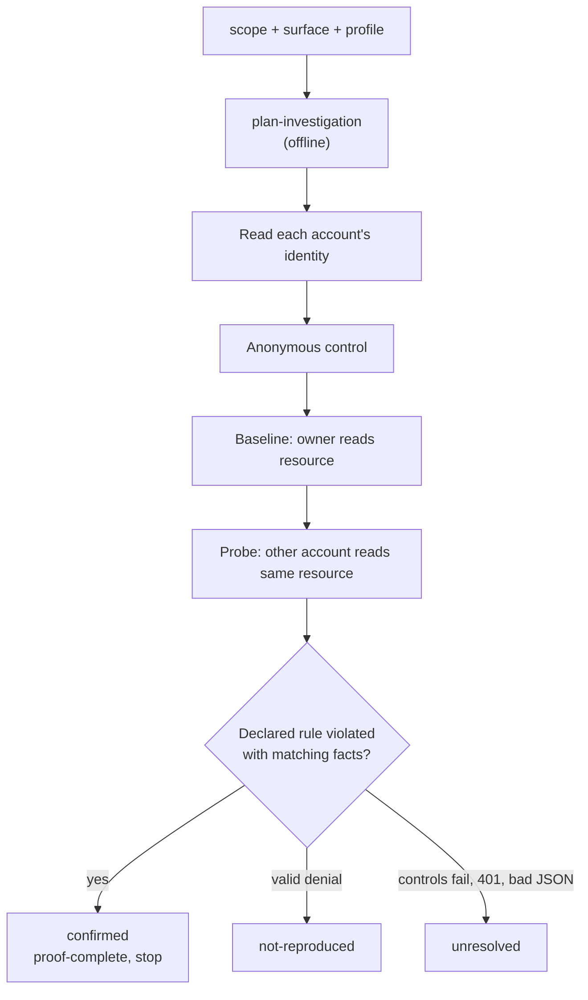

# Investigation from surface and semantic evidence

**English** · [Español](es/INVESTIGATION.md) · [Português (Brasil)](pt-BR/INVESTIGATION.md) · [简体中文](zh/INVESTIGATION.md)

The skill prepares contracts from the service, documentation, and current policy. The operator supplies controlled accounts and business rules that cannot be checked publicly. An import or written rule does not establish real authorization.

## Workflow

```powershell
node dist/cli.js capabilities
node dist/cli.js import-surface --format openapi --input api.json --out surface.json
node dist/cli.js plan-investigation --scope scope.json --surface surface.json --profile profile.json --out runs/plan
node dist/cli.js investigate --scope scope.json --surface surface.json --profile profile.json --out runs/investigation
```



Planning is offline. `investigate` sends GET requests to verify identities, run control/baseline/probe, evaluate facts, and write a report. It stops at the first confirmation (`proof-complete`), leaving other hypotheses pending. With no representable hypothesis, it writes coverage and report without requests and exits 3. Output includes scope, profile, plan, checks, checksummed/provenance-aware `coverage.json`, checkpointed `run/`, `semantic.json`, and `report.md`. A crash retains SQLite reservations. `resume-investigation <case-dir> --scope <canonical-scope> --out <new-report.md>` verifies definitions and scope, reevaluates retained evidence, and sends nothing after confirmed proof. Uncertain reservations are not repeated. Other terminal stops require reviewing errors and budget before a new case.

## Profile

For two owned accounts and private documents, a structural example is:

```json
{
  "schemaVersion": 1,
  "accounts": ["BBA_TOKEN_A", "BBA_TOKEN_B"],
  "identity": {
    "url": "https://service.example/me",
    "fact": "identity",
    "observe": [{ "name": "identity", "pointer": "/id" }]
  },
  "rules": [{
    "class": "bola",
    "origin": "https://service.example",
    "pathPrefix": "/documents",
    "protectedPointer": "/privateNotes",
    "subjectPointer": "/ownerId",
    "query": [],
    "policy": {
      "reference": "program private document rule",
      "boundary": "owner-only",
      "ownerFact": "owner"
    }
  }]
}
```

Rules match origin and path-segment prefix within exact scope; they do not make every document yours. Resources must belong to controlled accounts. Query endpoints need `{ name, valueEnv: "BBA_INPUT_..." }` and transport rules for those names. Numeric/UUID historical URLs may become templates and are not executed as such. Optional `bindings: [{ entryId, url }]` ties an entry to a concrete owned-resource URL, validated against template and scope. Unknown origins, unsupported methods, missing rules, and insufficient budget are explicit coverage gaps.

## Confirmed classes

| Class | Declared policy | Required server facts |
|---|---|---|
| `bola` | `owner-only`, `ownerFact` | Resource owner equals baseline identity |
| `bfla` | `role-private`, `roleFact`, `baselineRole`, `probeRole` | Distinct server-returned roles match declared roles |
| `property-exposure` | Same as BFLA | Selected private property crosses the role boundary |
| `tenant-isolation` | `tenant-private`, `tenantFact`, `resourceTenantFact` | Distinct server-returned tenants; resource tenant equals baseline's |

For roles, project the fact from identity and use `subjectPointer: null`; for tenants, project both identity and resource tenant. `protectedPointer` identifies the field forbidden to the restricted account. Identities must be distinct, of the same type, obtained before comparison with the credentials later used for baseline/probe. Identity and resource endpoints share an origin. Anonymous control must be denied and baseline must return meaningful protected data. Probe confirmation requires that same data and ownership/role/tenant controls. Compare selected fields, not whole bodies that may differ by timestamp or nonce. Equal body hashes alone prove nothing. Probe 401 is inconclusive (session expiry); 403/404 with valid controls is `not-reproduced` for that comparison. Missing field may be negative for that field; different value or invalid JSON is inconclusive. Privacy and absence of shared permission remain operator verified preconditions.

## Facts and evidence

`run` steps accept `observe: [{ name, pointer }]` using RFC 6901 JSON Pointer. Stored facts contain name, presence, type, significance, and SHA-256, distinguishing absent, null, and unreadable. Original values are never saved.

```powershell
node dist/cli.js evaluate-semantic runs/investigation/run --checks runs/investigation/checks.json --out runs/result.md
node dist/cli.js evidence-view runs/investigation/run --query view.json
node dist/cli.js compare-runs --before runs/old --after runs/new --out runs/comparison.json
```

`view.json` example: `{ "kind": "summary", "offset": 0, "limit": 20 }`. For pages use `attempts` or `fields`, offset/limit 1–50, and optional `stepId`. Carry `revisionDigest` as `expectedDigest` to reject a changed resumed revision. IDs are `sessionId:stepId` and `sessionId:stepId:factName`. Comparison links both revisions and distinguishes definition, response, and fact changes without classifying bugs. Credential/input values cannot be compared; input digests are bound to a session. Low-entropy hashes can be guessed and artifacts do not authenticate their operator.

For `hunt`, `browser-check`, and `browser-scenario`, `artifact.json` binds journal/result to scope/config digests. `artifact-view <dir> --query view.json` verifies files and supports `summary`, `events`, or `fields`, pagination, `eventType`, and optional `expectedDigest`. Event IDs are stable ordinals. Old unsealed or interrupted artifacts retain their old format; inspect raw files and budget without assuming a complete journal.

## Budget across phases

New scopes should carry `budgetId`, e.g. `dcs-public-pilot`. CLI/MCP keep `.bba-budgets/<budgetId>/` next to the original scope file; reuse its canonical path across run/resume, capture, hunt, investigate, and browser-check.

```powershell
node dist/cli.js inspect-budget .bba-budgets/dcs-public-pilot
```

Count, interval, and total duration survive new output folders and process crashes. Authorization and limits cannot be changed for that budget; phases may narrow their surface. A SQLite lock prevents concurrent phases. A global reservation is committed before sending and consumed if outcome is uncertain. A local reservation may consume local budget even without a global network reservation. Checkpoints pin budget location and reject another ledger. Do not delete/copy/rename it to reset consumption. Older scopes without `budgetId` retain per-run semantics. External tools and off-BBA browsing need separate accounting. Budget is an operational control, not proof of permission or protection against someone who can rewrite all files.
