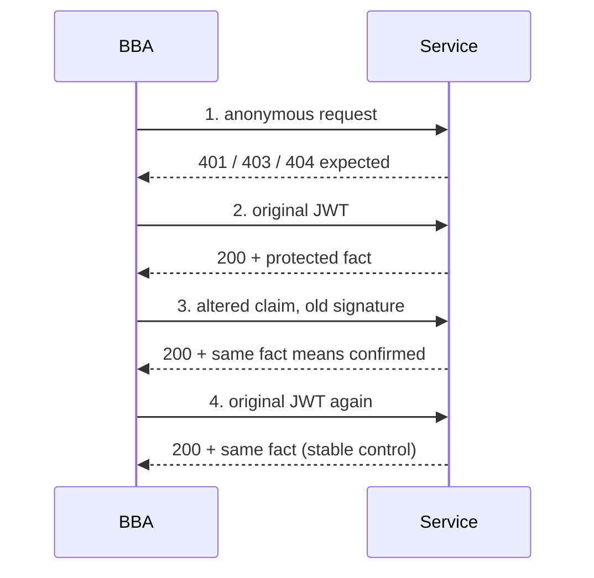

# Signed JWT integrity

**English** · [Español](es/JWT-INTEGRITY.md) · [Português (Brasil)](pt-BR/JWT-INTEGRITY.md) · [简体中文](zh/JWT-INTEGRITY.md)

This check answers a narrow question: does a service accept a JWT from a test account you own after its payload changes **without a new signature**? A positive result proves that route accepted a token whose signature does not match its contents. It does not prove access to another identity, administrator privileges, or other data.

## How the skill reaches this hypothesis

The published [Titan case](https://blog.faav.net/how-i-couldve-accessed-17-trillion-microsoft-records) combined a separate API, public Swagger, archived configuration clues, claim mutations, and a minimal confirming query. Its total record count was estimated from metadata, not a data dump. BBA distinguishes declared routes in offline OpenAPI/Swagger, potentially stale historical clues, current in-scope observations, and confirmation: denied anonymous control, stable valid token, and altered token accepted for a protected fact on your own account. A VPN frontend does not establish API controls or authorize discovered hosts. Review policy for each host, technique, method, and resource. Validation errors are clues, never proof by themselves.

## Contract

Use an authorized route and a harmless query returning only a private fact belonging to your test account. Body and secrets come from environment variables:

```json
{
  "schemaVersion": 1,
  "policyReference": "program rule for owned account",
  "boundary": "jwt-signature-integrity",
  "url": "https://service.example/v2/Query",
  "request": { "method": "POST", "body": { "format": "json", "valueEnv": "BBA_BODY_QUERY" } },
  "credentialEnv": "BBA_TOKEN_OWNED",
  "proofPointer": "/result",
  "mutation": { "claim": "bba_probe", "mode": "add-canary" }
}
```

`replace` may instead change an existing claim using `valueEnv: "BBA_INPUT_OWN_VALUE"`. Use only values and identities you control, not guessed users or privileged roles. `add-canary` adds a deterministic claim derived from the original token. Neither mode changes the signature. The starting token must be a signed, compact three-part JWT; `alg: none` is rejected as input. Scope must permit the exact URL and a POST `requestRule` with JSON format. State-changing routes require policy coverage and disposable resources. `proofPointer` selects a harmless, nonpublic JSON fact. Only presence, type, significance, and SHA-256 are saved; low-entropy values may be guessed from a hash.

## Run and interpret

```powershell
$env:BBA_TOKEN_OWNED = '<signed JWT of your own test account>'
$env:BBA_BODY_QUERY = '{"query":"SELECT 1","tableName":"OwnedTestData","rowLimit":1}'
node dist/cli.js jwt-check --scope scope.json --config jwt-check.json --out runs/jwt-check
node dist/cli.js evaluate-jwt runs/jwt-check/run --config jwt-check.json --out runs/jwt-evaluation.json
```

The SQL string illustrates a query against **owned test data**, not permission to query customer tables or production metadata. Choose the smallest request showing the protected fact; stop after confirmation. The engine sends exactly four requests to one endpoint with one body: anonymous, original JWT, altered JWT, original JWT again. It follows no redirects. Shared budget accounts for all attempts and intervals; 429/5xx stop the flow. Tokens stay in memory. Output stores salted token/mutation bindings, a credential-free plan, SQLite checkpoints, `result.json`, and a draft `report.md`. `evaluate-jwt` can also produce Markdown.



`confirmed` requires anonymous 401/403/404, two valid-token 200 controls with the same meaningful protected fact, and altered-token 200 with that fact. `not-reproduced` means this mutation was denied while the original stayed valid. Missing controls, different responses, or unreadable facts are `unresolved`. Resume requires the **same original token**, scope, config, and canonical budget:

```powershell
node dist/cli.js resume-jwt runs/jwt-check --scope scope.json --config jwt-check.json
```

Uncertain reservations are never repeated. If a response was lost after sending, that comparison remains inconclusive; a new case needs remaining budget and current authorization. `evaluate-jwt` is offline. Report only the observed account and route. Claims about other users, roles, or inventories require new authorization and controls. Document aggregate estimates and bounded samples as such; do not enumerate data to inflate impact.
