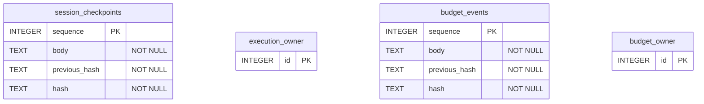

# Implemented persistence

**English** · [Español](es/database.md) · [Português (Brasil)](pt-BR/database.md) · [简体中文](zh/database.md)

Each static run has `session.sqlite` and `execution-lock.sqlite`. Each shared budget has `budget.sqlite` and `lock.sqlite`. The `owner` tables remain empty: a `BEGIN IMMEDIATE` transaction holds the process lock, released by the operating system when the process dies.

Diagram names identify both file and table; they are not additional tables. There are no SQL foreign keys across files. Event and selected-fact references such as `sessionId:stepId` live in `body` JSON and are validated by the application.

`session_checkpoints` means `session.sqlite/checkpoints`: immutable scope/plan snapshots, attempts, input/budget bindings, and redacted JSON facts. `budget_events` means `budget.sqlite/events`: initial authorization/limit digests and append-only `reserve`/`finish` events. Hash chains detect corruption but neither authenticate the operator nor stop a writer from replacing an entire history. Sources: `src/session.ts` and `src/budget.ts`. The model was checked against `CREATE TABLE` statements and lock, corruption, and process-death tests. Mermaid syntax was reviewed manually; no local Mermaid parser was installed.
