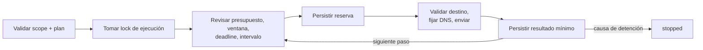
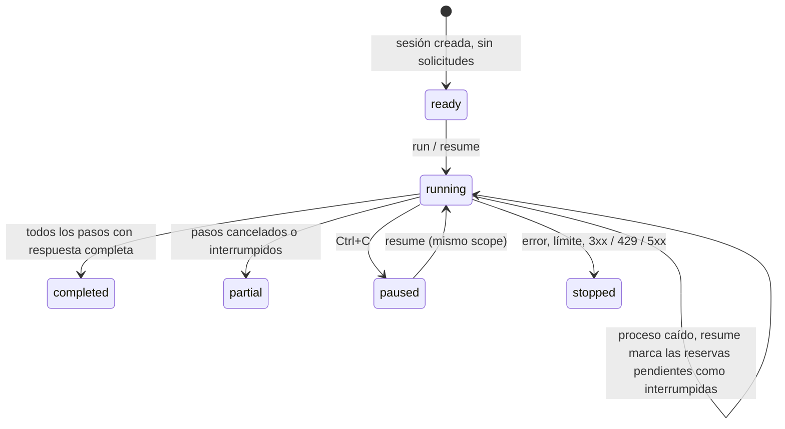

# Núcleo de ejecución

[English](../EXECUTION.md) · **Español** · [Português (Brasil)](../pt-BR/EXECUTION.md) · [简体中文](../zh/EXECUTION.md)

Este bloque ejecuta planes HTTP finitos con alcance verificable por código y conserva intentos entre procesos. Las respuestas HTTP son observaciones; las [comprobaciones semánticas](INVESTIGATION.md) y las [pruebas de navegador](BROWSER-CHECKS.md) agregan sus propios criterios de confirmación. `lab` conserva su formato anterior.

## Preparar un scope

El contrato se valida en [src/scope.ts](../../src/scope.ts). `scope-check` es offline: no lee políticas remotas ni convierte una referencia escrita en permiso. La política/autoridad real, las técnicas admitidas y la ausencia de efectos no deseados de cada GET se verifican antes de ejecutar.

| Campo | Requisito |
|---|---|
| `schemaVersion` | `1` |
| `mode` | `loopback-lab` para HTTP a `127.0.0.1` con puerto explícito; `public-https` para HTTPS a direcciones públicas permitidas |
| `authorization` | `reference` sin secretos y timestamps UTC ISO `validFrom` / `validUntil` |
| `allowed` | Lista de `{ origin, paths }`; coincidencia exacta, sin wildcards |
| `excluded` | Mismo formato; la exclusión siempre prevalece |
| `requestHeaders` | Opcional: lista de `{ origin, name, valueEnv }` por origen permitido. Nombre lowercase `user-agent` o `x-*`; valor desde una variable `BBA_HEADER_*`, nunca literal |
| `requestRules` | Opcional: `{ origin, path, method, queryNames, bodyFormats }` por operación exacta; requiere que el path esté permitido y no excluido |
| `budgetId` | Opcional para compatibilidad; los scopes nuevos deben usarlo para compartir el presupuesto entre fases en la ubicación canónica del scope |
| `limits.maxRequests` | Presupuesto total de la investigación, de 1 a 100 intentos |
| `limits.minIntervalMs` | Separación mínima entre el final de un intento y el inicio del siguiente, de 0 a 60000 ms |
| `limits.timeoutMs` | Deadline por solicitud, incluyendo DNS y lectura; de 1 a 60000 ms |
| `limits.maxResponseBytes` | Máximo del cuerpo recibido por solicitud, de 1 byte a 1 MiB |
| `limits.maxDurationMs` | Duración máxima desde la creación, de 1 ms a 24 h; incluye pausas |

Las URLs deben ser canónicas. No se admiten query strings, fragmentos, credenciales embebidas, escapes porcentuales, segmentos normalizados ni rutas ambiguas. No pongas secretos ni datos personales en referencias, IDs o paths: esos campos se conservan como metadatos. El scope completo queda congelado por digest; incluso ampliar su vigencia requiere una investigación nueva.

Sin reglas adicionales, el scope conserva GET sin query/body. `requestRules` habilita GET, HEAD, OPTIONS, POST, PUT, PATCH o DELETE, nombres de parámetros y formatos de cuerpo seleccionados. No autoriza efectos implícitos: revisar cada operación, usar recursos controlados y prever cleanup para cambios de estado. No se siguen redirects ni se admiten escapes de path, wildcards o queries embebidas en URL.

Ejemplo de operación explícita: `{ "origin": "https://service.example", "path": "/api/search", "method": "POST", "queryNames": ["page"], "bodyFormats": ["json"] }`. Solo habilita esa combinación de origen/path/método y los inputs declarados. Las exclusiones prevalecen. GET/HEAD no admiten body.

`requestHeaders` configura identificación requerida por el programa, no autenticación ni pruebas de spoofing. Cada par origen/nombre debe ser único. Los valores se resuelven antes de ejecutar, deben ser ASCII imprimible de 1 a 512 caracteres y se descartan de la evidencia. Se bloquean valores faltantes, CR/LF y nombres de auth/transporte. La misma restricción de origen aplica a solicitudes del navegador. Agregar o cambiar referencias modifica el digest del scope; no se aplica silenciosamente a una reanudación anterior.

`prepare --scope scope.json --target <URL-exacta> --out <carpeta-nueva>` crea un caso offline con copia del scope, plan semilla y registro de investigación. No verifica la autoridad real ni envía solicitudes. El agente completa política y precondiciones antes de ejecutar ese plan. No convierte URLs descubiertas en permisos nuevos.

## Preparar un plan

`plan.json` contiene `schemaVersion: 1` y `steps`, de 1 a 100 pasos ordenados. Los campos requeridos de cada paso son:

```json
{
  "id": "owner-control",
  "method": "GET",
  "url": "http://127.0.0.1:8787/documents/example",
  "credentialEnv": "BBA_TOKEN_ACCOUNT_A"
}
```

Es un ejemplo de estructura, no un target a ejecutar. Para una demo real autoconfigurada, usá `npm run demo:core -- --out runs/core-demo`.

Opcionales: `query: [{ name, valueEnv: "BBA_INPUT_PAGE" }]`, `body: { format: "json", valueEnv: "BBA_BODY_SEARCH" }` y `observe: [{ name: "id", pointer: "/result/id" }]`. Los valores no viajan como argumentos ni se guardan. Query: hasta 20 nombres únicos, 2048 bytes por valor y URL resuelta de hasta 8192 caracteres. Body: hasta 64 KiB; formatos JSON, form y text. JSON se valida antes de reservar red. Un digest ligado a la sesión fija todos los inputs al comenzar y bloquea cambios al retomar. Conservar esos valores originales en el entorno; rotar credenciales no equivale a cambiar inputs.

`credentialEnv` puede ser `null` para acceso anónimo o el nombre de una variable `BBA_TOKEN_*` (se envía como Bearer) o `BBA_COOKIE_*` (se envía como header `Cookie`, formato `nombre=valor; nombre2=valor2`). El operador proporciona el valor por su entorno; BBA no lo incluye en argumentos, resultados, logs ni base de evidencia. Variables faltantes o formato inválido fallan antes de reservar solicitudes. Los valores no se guardan para reanudaciones: deben seguir disponibles en el entorno correspondiente.

## Ejecución y red

1. Validar scope/plan, tomar el bloqueo exclusivo de la investigación y verificar checkpoints previos.
2. Resolver intentos reservados sin resultado como `interrupted`; no reenviarlos ni devolver su presupuesto.
3. Revisar presupuesto, ventana, deadline, intervalo y cancelación. Persistir una reserva antes de enviar.
4. Validar destino, resolver DNS y fijar la dirección aceptada para esa conexión, manteniendo hostname/SNI y validación TLS.
5. Persistir el resultado mínimo o la causa de detención; continuar únicamente con el próximo paso permitido.



En modo público se rechazan resoluciones con direcciones privadas, loopback o rangos especiales conocidos, incluso respuestas mixtas. IPv6 se limita conservadoramente a un subconjunto global unicast; no se pretende aceptar toda dirección pública posible. Se valida cada conexión, sin re-resolver dentro del transporte. No se usan proxies del entorno, no se desactiva TLS y no se siguen redirecciones, aunque el destino alternativo aparezca en scope. No se reintentan fallos automáticamente.

El ejecutor es secuencial y comparte presupuesto entre pasos/orígenes. Con `budgetId`, CLI/MCP mantienen un ledger común entre fases junto al scope original, con lock, intervalo y duración total persistentes. Retomar con otro ledger se rechaza. Los scopes históricos sin ese campo siguen con presupuesto por ejecución. Ver [presupuesto entre fases](INVESTIGATION.md#presupuesto-entre-fases); las herramientas externas requieren contabilidad adicional.

## Checkpoints y recuperación

`session.sqlite` contiene snapshots versionados, con secuencia, hash del anterior y SHA-256 del estado. Cada reserva y resultado se confirma con `synchronous=FULL`. La carga comprueba todos los checkpoints, contratos, transiciones e inmutabilidad de evidencias completadas.

`execution-lock.sqlite` mantiene una transacción de bloqueo separada durante la ejecución. El sistema operativo la libera al morir el proceso, mientras los checkpoints ya confirmados sobreviven. No se usa un PID o un archivo de lock que haya que borrar manualmente. El directorio tiene `.initializing` hasta terminar la creación; si falla antes, queda incompleto y debe usarse otra salida.

| Estado | Significado / recuperación |
|---|---|
| `ready` | Creado sin solicitudes; `resume` puede comenzar |
| `running` | En ejecución; si murió el proceso, `resume` recupera reservas pendientes como inconclusas |
| `paused` | Cancelación; `resume` requiere el mismo scope vigente y credenciales pendientes |
| `stopped` | Error, límite o respuesta 3xx/429/5xx; revisar causa y crear otra investigación si corresponde |
| `completed` | Todos los pasos tienen respuesta completa; no significa que el target sea seguro |
| `partial` | Todos los pasos fueron consumidos, pero hubo solicitudes canceladas/interrumpidas sin resultado |



Una reserva anterior al envío puede consumir presupuesto aunque el proceso muera antes de alcanzar la red. Es conservador: nunca se afirma que una solicitud incierta no ocurrió. Al cancelar un request, tampoco se puede deshacer lo que el servidor ya procesó.

Ctrl+C solicita cancelación cooperativa. Si el proceso termina abruptamente, la recuperación se realiza en la siguiente invocación. No se extienden ventana, duración ni presupuesto al retomar. Los cambios del scope y la autorización vencida bloquean nuevas solicitudes. La herramienta no detecta por sí misma cambios remotos de política: deben relevarse antes de reanudar.

## Evidencia y compatibilidad

Se conservan `status`, tamaño, SHA-256 del cuerpo y, si se pidieron, hechos JSON proyectados (presencia/tipo/digest). El contenido original, headers y tokens se descartan de la sesión. Headers seleccionados CSP/CORS se entregan en memoria al navegador para sus comprobaciones. Para redirecciones/429/5xx se cierra sin leer el cuerpo, por eso el tamaño es cero y el hash corresponde al cuerpo vacío. Para errores de lectura la respuesta queda `null`.

Los hashes sirven para detectar corrupción e inconsistencias, no para autenticar al autor ni resistir a alguien que pueda reescribir la base y recalcular todo. Tampoco prueban por sí solos que no se eliminó un sufijo válido del historial. No tomes bases de terceros como autorización o evidencia confiable.

`inspect-run`, `export-run` y `report-run` son offline. Las exportaciones se crean exclusivamente en archivos nuevos; el JSON exportado es un snapshot para revisión, no un formato de importación/reanudación. Para recuperar, conservá la carpeta SQLite original. El `report.md` no transforma metadatos HTTP en hallazgos.

Los comandos antiguos `lab`, `inspect` y `report` siguen leyendo/escribiendo bundles schema 1 con `toolVersion: 0.1.0`. Las sesiones generales usan schema 2 y `toolVersion: 0.2.0`. No hay migración destructiva de los artefactos anteriores.

## Verificación y límites actuales

La suite usa HTTP real en loopback, incluyendo caída de proceso, cancelación, contención de locks, expiración, cambios de scope, presupuesto persistido, límites de respuesta y corrupción. DNS público se comprueba además con un resolver controlado. El piloto público DCS de 1.2 comprobó tres GET HTTPS y una captura de inicio con el presupuesto común; los escenarios de permisos e inputs se verifican en laboratorios controlados, sin extrapolarlos a ese sitio.

Node valida los contratos en ejecución y elimina los tipos. `npm run check` agrega TypeScript estricto para fuentes/scripts, y `npm run verify` ejecuta check, build y tests. GitHub Actions corre esa verificación en Ubuntu y Windows; no hay linter configurado. El núcleo usa bibliotecas de Node; `playwright-core` sirve captura y pruebas de navegador. TypeScript y tipos de Node son dependencias de desarrollo.
