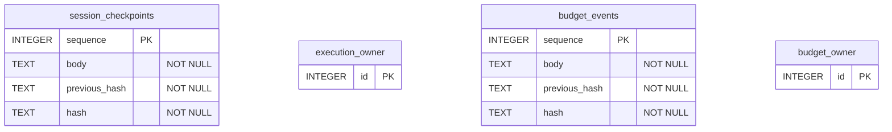

# Persistencia implementada

[English](../database.md) · **Español** · [Português (Brasil)](../pt-BR/database.md) · [简体中文](../zh/database.md)

Cada ejecución estática tiene `session.sqlite` y `execution-lock.sqlite`. Cada presupuesto compartido tiene `budget.sqlite` y `lock.sqlite`. Las tablas `owner` permanecen vacías: una transacción `BEGIN IMMEDIATE` mantiene el lock del proceso y el sistema operativo lo libera al morir.

Los nombres del diagrama identifican archivo y tabla; no son tablas adicionales. No hay claves foráneas SQL entre archivos. Las referencias `sessionId:stepId` de los eventos y los hechos seleccionados viven dentro del JSON de `body` y se validan en la aplicación.

`session_checkpoints` representa `session.sqlite/checkpoints`: snapshots inmutables de scope/plan, intentos, bindings de inputs/presupuesto y hechos JSON redactados. `budget_events` representa `budget.sqlite/events`: inicio con digests de autorización/límites y eventos append-only `reserve`/`finish`. Las cadenas de hashes detectan corrupción, sin autenticar al operador ni impedir que alguien con acceso de escritura reescriba un historial completo.

Fuentes: `src/session.ts` y `src/budget.ts`. El modelo se contrastó con las sentencias CREATE TABLE y pruebas de locks, corrupción y muerte de proceso. No hay un parser Mermaid local instalado; la sintaxis se revisó manualmente.
