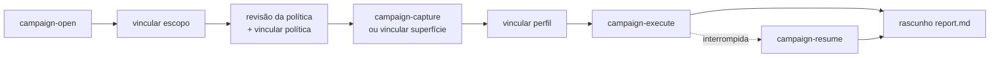

# Dossiê de campanha (1.9.0)

[English](../CAMPAIGNS.md) · [Español](../es/CAMPAIGNS.md) · **Português (Brasil)** · [简体中文](../zh/CAMPAIGNS.md)

Uma campanha coordena a pesquisa de um único alvo: fonte do escopo, revisão da política, superfície, perfil de contas próprias, execução e rascunho. Os vínculos ficam registrados num journal com cadeia de hashes. `campaign_status` revalida os arquivos e mostra o orçamento e o próximo passo. Detecta alterações acidentais ou inconsistências; não autentica o dono da política nem transforma uma observação em achado.



## Abertura e autorização

1. `campaign_open` / `campaign-open --target <url> --out <novo-diretório>` cria um caso sem requisições. O alvo deve ser uma URL canônica.
2. Escreva `scope.json` no caso com `budgetId` estável, janela de autorização vigente, ativos/rotas/métodos exatos, limites e referência de autorização. `campaign_link --kind scope` verifica a cobertura do alvo e congela esse escopo para o caso.
3. Leia a política oficial vigente do programa ou a permissão escrita do dono. Salve uma cópia em texto como `policy-source.txt`. `campaign-policy-review` / `campaign_policy_review` gera `policy.json`, vinculando o SHA-256 da fonte ao escopo e à decisão explícita do operador. Revise e vincule com `campaign-link --kind policy`. A forma histórica, sem cópia local, continua aceita:

```json
{
  "schemaVersion": 1,
  "sourceUrl": "https://program.example/policy",
  "reviewedAt": "2026-10-30T12:00:00.000Z",
  "scopeDigest": "<SHA-256 do escopo canônico>",
  "authorizationReference": "<igual a scope.authorization.reference>",
  "sourceKind": "official-program-policy",
  "operatorDecision": "authorized"
}
```

Escolha `uncertain` se não for possível estabelecer a permissão. Isso registra uma decisão humana; a ferramenta não busca nem valida a política. Uma URL de política, `security.txt` ou o mero interesse não autorizam testes ativos. `campaign_status` informa `policySourceBound` e detecta alterações na cópia local. Seu hash mostra a integridade da cópia, não a autenticidade da fonte nem a permissão do dono; guarde o link e a data da consulta.

## Fluxo MCP e CLI

Com MCP `--allow-network`, `campaign_capture` captura **uma vez a URL exata do alvo** com GET delimitados. Escreve `pages.json`, `capture.json` e `surface.json` em `actions/capture/output` e vincula os fatos observados da página e da superfície. Os caminhos do DOM são pistas, nunca visitados automaticamente nem adicionados ao escopo. CLI: `bba campaign-capture <caso>`.

Um bundle de superfície OpenAPI, Swagger, HAR ou REA pode, em vez disso, ser vinculado com `campaign_link --kind surface`. Vincule um perfil de investigação com duas identidades controladas e regras de negócio explícitas usando `--kind profile`. `campaign_status` mostra o número de verificações semânticas compiladas e as classes/entradas não cobertas. Novos perfis podem seguir novas superfícies; as revisões antigas permanecem no histórico.

`campaign_execute` / `bba campaign-execute <caso>` executa os controles anônimo, do dono e de outra conta **uma vez por perfil vigente** sob o orçamento compartilhado do escopo. Para na primeira prova semântica confirmada. A execução e o `report.md` são salvos em `actions/investigation-<sequência>/output` e vinculados ao concluir ou ao parar em `proof-complete`. As credenciais vêm de `BBA_TOKEN_*` ou `BBA_COOKIE_*` no ambiente do MCP, nunca de argumentos nem de arquivos do caso. Revise o impacto, a reprodução e as regras de divulgação antes de enviar o rascunho.

## Paradas e retomada

Um diretório de ação é reservado antes das requisições. Se a captura/investigação for interrompida, `campaign_status` mostra `interrupted-action` e não a executa de novo. Inspecione `started.json`, a saída e `inspect_budget`. Reservas incertas ou janelas expiradas bloqueiam novas ações. `campaign_resume` / `bba campaign-resume <caso>` compara o escopo, a superfície e o perfil atuais com um checkpoint pausado, retoma apenas as etapas não iniciadas, escreve `report-resumed.md` e vincula os artefatos concluídos. Uma execução terminal com relatório existente é vinculada sem novas requisições. A captura de navegador não tem retomada automática.

O rascunho semântico explica separadamente o problema, a descoberta, a prova, a reprodução e a correção. A prova retém o estado exato de cada verificação e os IDs de evidência; `unresolved` nunca vira impacto afirmado. O limite do journal é de 100 eventos, com caminhos confinados ao diretório do caso. As verificações automáticas cobrem hoje BOLA, BFLA, exposição de propriedades e isolamento de tenants para GET JSON sob identidade declarada e regras de negócio. Outros vetores exigem ferramentas próprias ou permanecem como lacunas. Um caso não afirma uma vulnerabilidade crítica nem cobertura completa da superfície.
