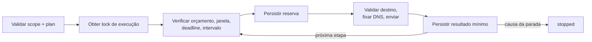
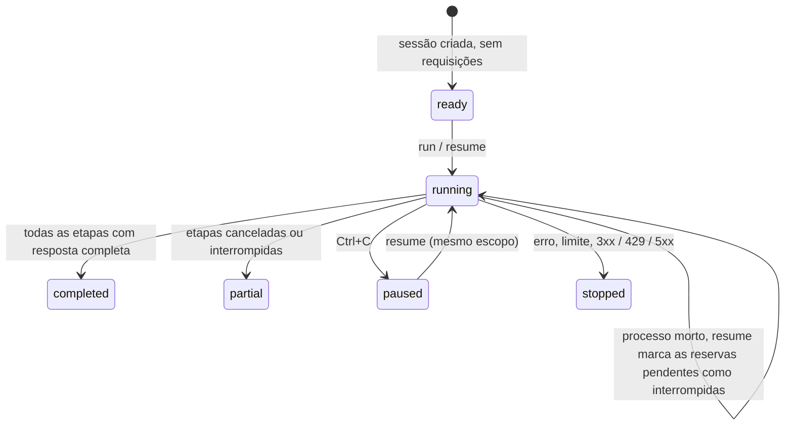

# Núcleo de execução

[English](../EXECUTION.md) · [Español](../es/EXECUTION.md) · **Português (Brasil)** · [简体中文](../zh/EXECUTION.md)

Este núcleo executa planos HTTP finitos sob um escopo verificado por código e persiste as tentativas entre processos. As respostas HTTP são observações; as [verificações semânticas](INVESTIGATION.md) e as [verificações de navegador](BROWSER-CHECKS.md) têm seus próprios critérios de confirmação. `lab` mantém seu formato anterior de artefatos.

## Preparar o escopo

[src/scope.ts](../../src/scope.ts) valida o contrato. `scope-check` é offline: não lê políticas remotas nem transforma uma referência escrita em permissão. Verifique a autoridade real, as técnicas permitidas e os efeitos seguros de cada GET antes de executar.

| Campo | Requisito |
|---|---|
| `schemaVersion` | `1` |
| `mode` | `loopback-lab`: HTTP para `127.0.0.1` com porta explícita; `public-https`: HTTPS para endereços públicos permitidos |
| `authorization` | `reference` sem segredos, `validFrom` / `validUntil` em ISO UTC |
| `allowed`, `excluded` | `{ origin, paths }` com correspondência exata, sem curingas; as exclusões prevalecem |
| `requestHeaders` | `{ origin, name, valueEnv }` opcional por origem; `user-agent` ou `x-*` em minúsculas, valor vindo de `BBA_HEADER_*` |
| `requestRules` | `{ origin, path, method, queryNames, bodyFormats }` exato e opcional dentro do caminho permitido |
| `budgetId` | Opcional em escopos antigos; os novos devem compartilhar o orçamento entre fases, junto ao escopo canônico |
| `limits.maxRequests` | 1–100 tentativas na investigação |
| `limits.minIntervalMs` | 0–60000 ms entre o fim de uma tentativa e o início da seguinte |
| `limits.timeoutMs` | 1–60000 ms, incluindo DNS e leitura |
| `limits.maxResponseBytes` | 1 byte–1 MiB por corpo de resposta |
| `limits.maxDurationMs` | 1 ms–24 horas desde a criação, incluindo pausas |

As URLs devem ser canônicas: sem queries, fragmentos, credenciais embutidas, escapes percentuais, segmentos normalizados nem caminhos ambíguos. Nunca coloque segredos nem dados pessoais em referências, IDs ou caminhos, que persistem como metadados. O escopo completo fica congelado por digest; até estender a validade exige uma nova investigação. Por padrão só é permitido GET sem query nem corpo. `requestRules` pode permitir explicitamente GET, HEAD, OPTIONS, POST, PUT, PATCH, DELETE, nomes de query selecionados e formatos de corpo. Revise cada operação que muda estado, use recursos controlados e planeje a limpeza. Redirecionamentos, escapes de caminho, curingas e queries embutidas em URLs continuam bloqueados. Uma regra de exemplo é `{ "origin": "https://service.example", "path": "/api/search", "method": "POST", "queryNames": ["page"], "bodyFormats": ["json"] }`. GET/HEAD nunca aceitam corpo.

Os `requestHeaders` de identificação não são autenticação nem testes de spoofing. Cada par origem/nome deve ser único; os valores têm de 1 a 512 caracteres ASCII imprimíveis, são resolvidos antes da execução e descartados da evidência. Valores ausentes, CR/LF e nomes de autenticação/transporte são bloqueados. As requisições do navegador seguem a mesma regra de origem. Mudar as referências altera o digest do escopo e não pode alterar silenciosamente uma execução retomada. `prepare --scope scope.json --target <url-exata> --out <novo-diretório>` escreve um caso offline, uma cópia do escopo, um plano inicial e notas, sem requisições nem prova de autoridade.

## Preparar o plano

`plan.json` tem `schemaVersion: 1` e de 1 a 100 etapas ordenadas, cada uma com ID, método, URL e referência de credencial:

```json
{
  "id": "owner-control",
  "method": "GET",
  "url": "http://127.0.0.1:8787/documents/example",
  "credentialEnv": "BBA_TOKEN_ACCOUNT_A"
}
```

Este é um exemplo estrutural; `npm run demo:core -- --out runs/core-demo` produz uma demonstração local real. Campos opcionais: `query: [{ name, valueEnv: "BBA_INPUT_PAGE" }]`, `body: { format: "json", valueEnv: "BBA_BODY_SEARCH" }`, `observe: [{ name: "id", pointer: "/result/id" }]`. Os valores de entrada nunca são argumentos nem são persistidos. As queries admitem até 20 nomes únicos, 2.048 bytes por valor e uma URL resolvida de até 8.192 caracteres. Os corpos admitem 64 KiB em JSON, formulário ou texto; o JSON é validado antes de uma reserva de rede. Digests vinculados à sessão fixam as entradas no início e rejeitam entradas alteradas na retomada. Preserve os valores originais no ambiente; a rotação de credenciais não permite mudar entradas.

`credentialEnv` é `null` para anônimo, ou uma string Bearer `BBA_TOKEN_*` ou Cookie `BBA_COOKIE_*` (`name=value; name2=value2`). Valores ausentes ou inválidos falham antes da reserva. Os valores nunca são guardados em argumentos, resultados, logs nem evidência; precisam estar disponíveis de novo para a retomada.

## Execução e rede

1. Validar scope/plan, obter o lock exclusivo de execução e verificar os checkpoints anteriores.
2. Marcar as reservas sem resultado como `interrupted`; não reenviá-las nem devolvê-las.
3. Verificar orçamento, janela de autorização, deadline, intervalo e cancelamento; persistir a reserva antes de enviar.
4. Validar o destino, resolver o DNS e fixar o endereço aceito para esta conexão, mantendo hostname/SNI e a validação TLS.
5. Persistir o resultado mínimo ou a causa da parada; continuar apenas com a próxima etapa permitida.



O modo público rejeita conjuntos de DNS que contenham endereços privados, loopback ou especiais conhecidos, inclusive respostas mistas. O IPv6 suporta, de forma conservadora, um subconjunto global-unicast. Cada conexão é validada sem uma nova resolução posterior no transporte. Proxies de ambiente não são usados, o TLS não é desabilitado, redirecionamentos não são seguidos nem para alvos dentro do escopo, e as falhas não são repetidas automaticamente. A execução é sequencial com orçamentos compartilhados por execução. Com `budgetId`, CLI/MCP compartilham um livro-razão durável e bloqueado entre fases; outro livro-razão é rejeitado na retomada. Escopos históricos continuam por execução. O [orçamento entre fases](INVESTIGATION.md#orçamento-entre-fases) o explica; ferramentas externas exigem contabilização adicional.

## Checkpoints e recuperação

`session.sqlite` guarda snapshots versionados com sequência, hash anterior e SHA-256 do estado; toda reserva e todo resultado são confirmados com `synchronous=FULL`. Ao carregar, verificam-se checkpoints, contratos, transições e imutabilidade da evidência concluída. `execution-lock.sqlite` mantém um lock de transação separado durante a execução. O SO o libera quando o processo morre; os checkpoints confirmados permanecem. Nenhum PID ou arquivo de lock precisa ser removido manualmente. `.initializing` marca um diretório incompleto se a criação falhar; escolha outra saída.

| Estado | Significado / recuperação |
|---|---|
| `ready` | Criado sem requisições; `resume` pode iniciar |
| `running` | Em andamento; a retomada após a morte do processo marca as reservas pendentes como inconclusivas |
| `paused` | Cancelado; `resume` exige o mesmo escopo válido e as credenciais pendentes |
| `stopped` | Erro, limite ou 3xx/429/5xx; revise a causa e, se for o caso, abra um novo caso |
| `completed` | Todas as etapas têm respostas completas; não é uma afirmação de segurança do alvo |
| `partial` | Todas as etapas foram consumidas, mas algumas foram canceladas/interrompidas sem resultado |



Uma reserva anterior ao envio pode consumir orçamento mesmo que o processo tenha morrido antes de chegar à rede; o BBA nunca afirma que uma requisição incerta não ocorreu. O cancelamento não desfaz o processamento no servidor. Ctrl+C solicita um cancelamento cooperativo. A retomada nunca estende a janela, a duração nem o orçamento. Mudanças no escopo ou autorização expirada bloqueiam novas requisições. Mudanças na política remota devem ser verificadas pelo operador antes de retomar.

## Evidência e compatibilidade

A evidência guardada inclui status, tamanho, SHA-256 do corpo e os fatos JSON projetados solicitados (presença, tipo, digest). O conteúdo original, os cabeçalhos e os tokens são descartados. Cabeçalhos CSP/CORS selecionados são passados em memória às verificações de navegador. Os corpos de redirecionamento/429/5xx não são lidos, então o tamanho é zero e o hash é o do corpo vazio; erros de leitura deixam a resposta como `null`. Os hashes detectam corrupção, mas não autoria nem a reescrita total do histórico, e não provam que nenhum sufixo válido foi removido. Não trate bancos de dados de terceiros como evidência confiável nem como autorização.

`inspect-run`, `export-run` e `report-run` são offline e só escrevem arquivos novos. O JSON exportado é um snapshot de revisão, não um formato de importação/retomada. Guarde o diretório SQLite original para a recuperação. `report.md` não transforma metadados HTTP em achados. Os históricos `lab`, `inspect` e `report` usam schema 1 / `toolVersion: 0.1.0`; as sessões gerais usam schema 2 / `toolVersion: 0.2.0`, sem migração destrutiva.

## Verificação e limites atuais

Os testes usam HTTP loopback real para morte de processo, cancelamento, disputa de lock, expiração, mudanças de escopo, orçamento persistente, limites de resposta e corrupção, além de DNS público com resolvedor controlado. O piloto público DCS 1.2 fez três GET HTTPS e uma captura da home sob um orçamento comum; permissões e cenários de entrada foram verificados apenas em laboratórios controlados. O Node valida os contratos em tempo de execução e remove os tipos. `npm run check` verifica fontes/scripts TypeScript, enquanto `npm run verify` executa check, build e testes. O GitHub Actions roda a verificação em Ubuntu e Windows; não há linter configurado. `playwright-core` suporta a captura e as verificações de navegador; TypeScript e os tipos do Node são dependências de desenvolvimento.
