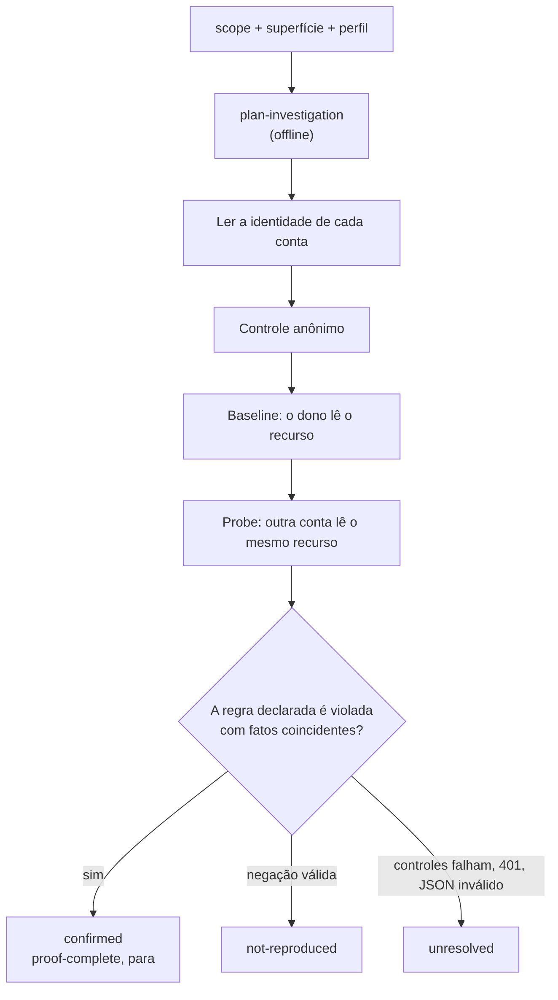

# Investigação a partir da superfície e da evidência semântica

[English](../INVESTIGATION.md) · [Español](../es/INVESTIGATION.md) · **Português (Brasil)** · [简体中文](../zh/INVESTIGATION.md)

A skill prepara os contratos a partir do serviço, da documentação e da política vigente. O operador fornece as contas controladas e as regras de negócio que não podem ser verificadas publicamente. Uma importação ou uma regra escrita não estabelece autorização real.

## Fluxo

```powershell
node dist/cli.js capabilities
node dist/cli.js import-surface --format openapi --input api.json --out surface.json
node dist/cli.js plan-investigation --scope scope.json --surface surface.json --profile profile.json --out runs/plan
node dist/cli.js investigate --scope scope.json --surface surface.json --profile profile.json --out runs/investigation
```



O planejamento é offline. `investigate` envia requisições GET para verificar identidades, executar controle/baseline/probe, avaliar fatos e escrever um relatório. Para na primeira confirmação (`proof-complete`), deixando as outras hipóteses pendentes. Sem nenhuma hipótese representável, escreve cobertura e relatório sem requisições e termina com 3. A saída inclui scope, perfil, plano, verificações, `coverage.json` com checksum e procedência, `run/` com checkpoints, `semantic.json` e `report.md`. Uma queda mantém as reservas SQLite. `resume-investigation <diretório-do-caso> --scope <escopo-canônico> --out <novo-report.md>` verifica as definições e o escopo, reavalia a evidência retida e não envia nada depois de uma prova confirmada. Reservas incertas não são repetidas. Outras paradas terminais exigem revisar erros e orçamento antes de um novo caso.

## Perfil

Para duas contas próprias e documentos privados, um exemplo estrutural é:

```json
{
  "schemaVersion": 1,
  "accounts": ["BBA_TOKEN_A", "BBA_TOKEN_B"],
  "identity": {
    "url": "https://service.example/me",
    "fact": "identity",
    "observe": [{ "name": "identity", "pointer": "/id" }]
  },
  "rules": [{
    "class": "bola",
    "origin": "https://service.example",
    "pathPrefix": "/documents",
    "protectedPointer": "/privateNotes",
    "subjectPointer": "/ownerId",
    "query": [],
    "policy": {
      "reference": "program private document rule",
      "boundary": "owner-only",
      "ownerFact": "owner"
    }
  }]
}
```

As regras correspondem por origem e prefixo de segmento de caminho dentro do escopo exato; não tornam seus todos os documentos. Os recursos devem pertencer a contas controladas. Endpoints com query precisam de `{ name, valueEnv: "BBA_INPUT_..." }` e de regras de transporte para esses nomes. URLs históricas numéricas/UUID podem virar templates e não são executadas como tais. O campo opcional `bindings: [{ entryId, url }]` vincula uma entrada a uma URL concreta de recurso próprio, validada contra o template e o escopo. Origens desconhecidas, métodos não suportados, regras ausentes e orçamento insuficiente são lacunas de cobertura explícitas.

## Classes confirmadas

| Classe | Política declarada | Fatos exigidos do servidor |
|---|---|---|
| `bola` | `owner-only`, `ownerFact` | O dono do recurso é igual à identidade do baseline |
| `bfla` | `role-private`, `roleFact`, `baselineRole`, `probeRole` | Papéis distintos devolvidos pelo servidor coincidem com os declarados |
| `property-exposure` | Igual a BFLA | A propriedade privada selecionada cruza o limite entre papéis |
| `tenant-isolation` | `tenant-private`, `tenantFact`, `resourceTenantFact` | Tenants distintos devolvidos pelo servidor; o tenant do recurso é igual ao do baseline |

Para papéis, projete o fato a partir da identidade e use `subjectPointer: null`; para tenants, projete tanto o tenant da identidade quanto o do recurso. `protectedPointer` identifica o campo proibido para a conta restrita. As identidades devem ser distintas, do mesmo tipo, e obtidas antes da comparação com as credenciais usadas depois no baseline/probe. Os endpoints de identidade e de recurso compartilham a origem. O controle anônimo deve ser negado e o baseline deve devolver dados protegidos significativos. A confirmação do probe exige esses mesmos dados e os controles de propriedade/papel/tenant. Compare campos selecionados, não corpos inteiros que podem diferir por timestamp ou nonce. Hashes de corpo iguais, isolados, não provam nada. 401 no probe é inconclusivo (sessão expirada); 403/404 com controles válidos é `not-reproduced` para essa comparação. A ausência do campo pode ser negativa para esse campo; um valor diferente ou JSON inválido é inconclusivo. Privacidade e ausência de permissão compartilhada continuam sendo pré-condições verificadas pelo operador.

## Fatos e evidência

As etapas de `run` aceitam `observe: [{ name, pointer }]` com JSON Pointer RFC 6901. Os fatos guardados contêm nome, presença, tipo, significância e SHA-256, distinguindo ausente, null e ilegível. Os valores originais nunca são salvos.

```powershell
node dist/cli.js evaluate-semantic runs/investigation/run --checks runs/investigation/checks.json --out runs/result.md
node dist/cli.js evidence-view runs/investigation/run --query view.json
node dist/cli.js compare-runs --before runs/old --after runs/new --out runs/comparison.json
```

Exemplo de `view.json`: `{ "kind": "summary", "offset": 0, "limit": 20 }`. Para páginas use `attempts` ou `fields`, offset/limit de 1 a 50 e `stepId` opcional. Leve `revisionDigest` como `expectedDigest` para rejeitar uma revisão retomada que tenha mudado. Os IDs são `sessionId:stepId` e `sessionId:stepId:factName`. A comparação vincula as duas revisões e distingue mudanças de definição, de resposta e de fatos, sem classificar bugs. Valores de credenciais/entradas não podem ser comparados; os digests de entrada estão vinculados a uma sessão. Hashes de baixa entropia podem ser adivinhados e os artefatos não autenticam seu operador.

Para `hunt`, `browser-check` e `browser-scenario`, `artifact.json` vincula journal/resultado aos digests de scope/config. `artifact-view <dir> --query view.json` verifica os arquivos e suporta `summary`, `events` ou `fields`, paginação, `eventType` e `expectedDigest` opcional. Os IDs de evento são ordinais estáveis. Artefatos antigos sem selo ou interrompidos mantêm o formato antigo; inspecione os arquivos brutos e o orçamento sem supor um journal completo.

## Orçamento entre fases

Os novos escopos devem trazer `budgetId`, por exemplo `dcs-public-pilot`. CLI/MCP mantêm `.bba-budgets/<budgetId>/` ao lado do arquivo de escopo original; reutilize seu caminho canônico em run/resume, capture, hunt, investigate e browser-check.

```powershell
node dist/cli.js inspect-budget .bba-budgets/dcs-public-pilot
```

A contagem, o intervalo e a duração total sobrevivem a novas pastas de saída e a quedas de processo. A autorização e os limites não podem ser alterados para esse orçamento; as fases podem restringir sua superfície. Um lock SQLite impede fases concorrentes. Uma reserva global é confirmada antes do envio e consumida se o resultado for incerto. Uma reserva local pode consumir o orçamento local mesmo sem uma reserva global de rede. Os checkpoints fixam a localização do orçamento e rejeitam outro livro-razão. Não apague, copie nem renomeie para zerar o consumo. Escopos antigos sem `budgetId` mantêm a semântica por execução. Ferramentas externas e navegação fora do BBA exigem contabilização à parte. O orçamento é um controle operacional, não uma prova de permissão nem proteção contra quem possa reescrever todos os arquivos.
