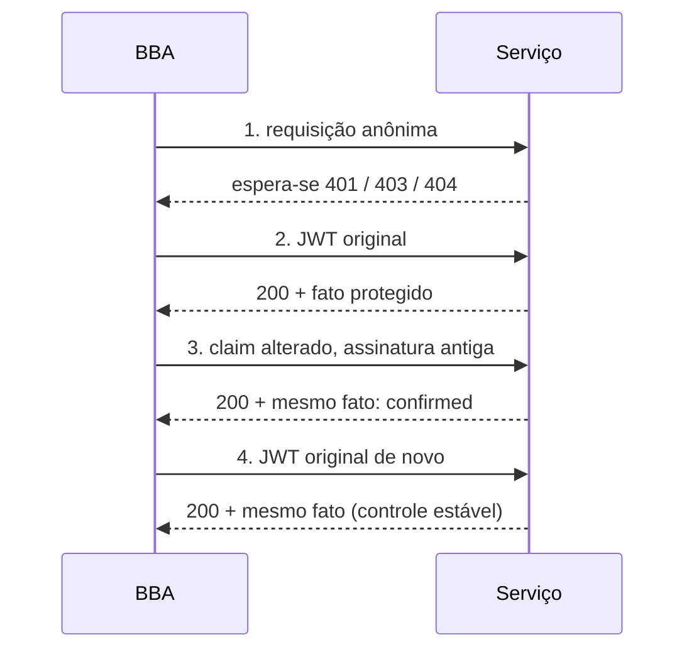

# Integridade de JWT assinado

[English](../JWT-INTEGRITY.md) · [Español](../es/JWT-INTEGRITY.md) · **Português (Brasil)** · [简体中文](../zh/JWT-INTEGRITY.md)

Esta verificação responde a uma pergunta estreita: um serviço aceita um JWT de uma conta de teste sua depois que o payload muda **sem uma nova assinatura**? Um resultado positivo prova que aquela rota aceitou um token cuja assinatura não corresponde ao conteúdo. Não prova acesso a outra identidade, privilégios de administrador nem outros dados.

## Como a skill chega a esta hipótese

O [caso Titan](https://blog.faav.net/how-i-couldve-accessed-17-trillion-microsoft-records) publicado combinou uma API separada, Swagger público, pistas de configuração arquivada, mutações de claims e uma consulta mínima de confirmação. A contagem total de registros foi estimada a partir de metadados, não de um despejo de dados. O BBA distingue rotas declaradas em OpenAPI/Swagger offline, pistas históricas possivelmente obsoletas, observações atuais dentro do escopo e a confirmação: controle anônimo negado, token válido estável e token alterado aceito para um fato protegido da sua própria conta. Um frontend de VPN não estabelece controles da API nem autoriza hosts descobertos. Revise a política para cada host, técnica, método e recurso. Erros de validação são pistas, nunca prova por si sós.

## Contrato

Use uma rota autorizada e uma consulta inofensiva que devolva apenas um fato privado da sua conta de teste. O corpo e os segredos vêm de variáveis de ambiente:

```json
{
  "schemaVersion": 1,
  "policyReference": "program rule for owned account",
  "boundary": "jwt-signature-integrity",
  "url": "https://service.example/v2/Query",
  "request": { "method": "POST", "body": { "format": "json", "valueEnv": "BBA_BODY_QUERY" } },
  "credentialEnv": "BBA_TOKEN_OWNED",
  "proofPointer": "/result",
  "mutation": { "claim": "bba_probe", "mode": "add-canary" }
}
```

`replace` pode, em vez disso, mudar um claim existente usando `valueEnv: "BBA_INPUT_OWN_VALUE"`. Use apenas valores e identidades que você controla, não usuários adivinhados nem papéis privilegiados. `add-canary` adiciona um claim determinístico derivado do token original. Nenhum dos dois modos altera a assinatura. O token inicial deve ser um JWT compacto de três partes, assinado; `alg: none` é rejeitado como entrada. O escopo deve permitir a URL exata e uma `requestRule` POST com formato JSON. Rotas que mudam estado exigem cobertura da política e recursos descartáveis. `proofPointer` seleciona um fato JSON inofensivo e não público. Só presença, tipo, significância e SHA-256 são salvos; valores de baixa entropia podem ser adivinhados a partir de um hash.

## Executar e interpretar

```powershell
$env:BBA_TOKEN_OWNED = '<JWT assinado da sua própria conta de teste>'
$env:BBA_BODY_QUERY = '{"query":"SELECT 1","tableName":"OwnedTestData","rowLimit":1}'
node dist/cli.js jwt-check --scope scope.json --config jwt-check.json --out runs/jwt-check
node dist/cli.js evaluate-jwt runs/jwt-check/run --config jwt-check.json --out runs/jwt-evaluation.json
```

A string SQL ilustra uma consulta sobre **dados de teste próprios**, não permissão para consultar tabelas de clientes nem metadados de produção. Escolha a menor requisição que mostre o fato protegido; pare após a confirmação. O motor envia exatamente quatro requisições a um endpoint com um corpo: anônima, JWT original, JWT alterado, JWT original de novo. Não segue redirecionamentos. O orçamento compartilhado contabiliza todas as tentativas e intervalos; 429/5xx interrompem o fluxo. Os tokens ficam em memória. A saída guarda vínculos de token/mutação com sal, um plano sem credenciais, checkpoints SQLite, `result.json` e um rascunho `report.md`. `evaluate-jwt` também pode produzir Markdown.



`confirmed` exige anônimo 401/403/404, dois controles 200 com token válido com o mesmo fato protegido significativo e 200 com o token alterado trazendo esse fato. `not-reproduced` significa que esta mutação foi negada enquanto o original continuou válido. Controles ausentes, respostas diferentes ou fatos ilegíveis são `unresolved`. A retomada exige o **mesmo token original**, o mesmo escopo, a mesma configuração e o mesmo orçamento canônico:

```powershell
node dist/cli.js resume-jwt runs/jwt-check --scope scope.json --config jwt-check.json
```

Reservas incertas nunca são repetidas. Se uma resposta se perdeu depois do envio, essa comparação permanece inconclusiva; um novo caso exige orçamento restante e autorização vigente. `evaluate-jwt` é offline. Reporte apenas a conta e a rota observadas. Afirmações sobre outros usuários, papéis ou inventários exigem nova autorização e novos controles. Documente estimativas agregadas e amostras limitadas como tais; não enumere dados para inflar o impacto.
