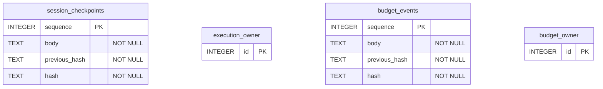

# Persistência implementada

[English](../database.md) · [Español](../es/database.md) · **Português (Brasil)** · [简体中文](../zh/database.md)

Cada execução estática tem `session.sqlite` e `execution-lock.sqlite`. Cada orçamento compartilhado tem `budget.sqlite` e `lock.sqlite`. As tabelas `owner` permanecem vazias: uma transação `BEGIN IMMEDIATE` mantém o lock do processo, liberado pelo sistema operacional quando o processo morre.

Os nomes do diagrama identificam arquivo e tabela; não são tabelas adicionais. Não há chaves estrangeiras SQL entre arquivos. Referências de eventos e de fatos selecionados, como `sessionId:stepId`, vivem no JSON de `body` e são validadas pela aplicação.

`session_checkpoints` significa `session.sqlite/checkpoints`: snapshots imutáveis de scope/plan, tentativas, vínculos de entrada/orçamento e fatos JSON redigidos. `budget_events` significa `budget.sqlite/events`: digests iniciais de autorização/limite e eventos `reserve`/`finish` somente de acréscimo. As cadeias de hash detectam corrupção, mas não autenticam o operador nem impedem que um escritor substitua todo o histórico. Fontes: `src/session.ts` e `src/budget.ts`. O modelo foi conferido com as instruções `CREATE TABLE` e com testes de lock, corrupção e morte de processo. A sintaxe Mermaid foi revisada manualmente; nenhum parser Mermaid local estava instalado.
