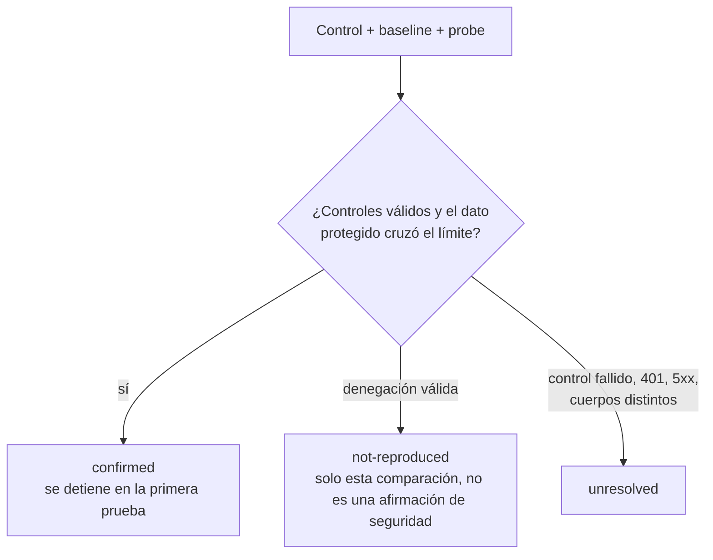
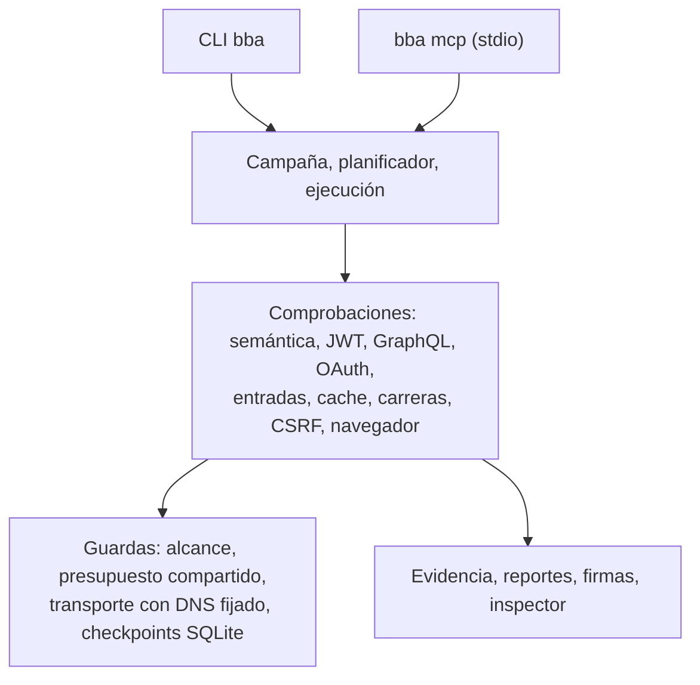

<div align="center">

[English](../../README.md) · **Español** · [Português (Brasil)](README_pt-BR.md) · [简体中文](README_zh.md)

# BBA: Bug Bounty Anything

### Una skill de agente y un motor CLI/MCP locales para investigar vulnerabilidades con autorización y evidencia verificable.

**Apuntá tu agente a un servicio autorizado. Obtené pruebas acotadas, evidencia reproducible y un borrador de reporte que revisás vos.**

[](https://www.npmjs.com/package/bug-bounty-anything)
[](../../.github/workflows/ci.yml)
[](#requisitos)
[](../es/installation.md#instalación-diagnóstico-y-mcp)
[](../../LICENSE)

[Inicio rápido](#inicio-rápido) · [Cómo funciona BBA](#cómo-funciona-bba) · [Qué podés comprobar](#qué-podés-comprobar) · [Ejemplos](#ejemplos) · [Preguntas frecuentes](#preguntas-frecuentes) · [Documentación](#documentación)

<code>npx --yes bug-bounty-anything@latest capabilities</code>

</div>

> [!IMPORTANT]
> Obtené BBA desde [matiasdante/bug-bounty-anything](https://github.com/matiasdante/bug-bounty-anything)
> o el [paquete npm bug-bounty-anything](https://www.npmjs.com/package/bug-bounty-anything).
> Un nombre de repositorio parecido o un README copiado no demuestra que una descarga sea oficial.
> BBA es para servicios que estás autorizado a probar. Leé primero el [aviso de divulgación](../../DISCLOSURE).

---

Para un servicio autorizado, tu agente establece el alcance y la política del programa, prepara un caso, proyecta la superficie de ataque, ejecuta comparaciones acotadas con cuentas que controlás y redacta un reporte. Cada conclusión incluye su evidencia y sus límites. BBA nunca envía un reporte por su cuenta.

No es un scanner general. El agente conduce la investigación; el motor local aporta HTTP y Chromium acotados, importadores offline, evidencia persistente y comprobaciones de autorización, entradas, cache, carreras y navegador. No encontrar una vulnerabilidad confirmada es un resultado válido, y nunca se afirma más cobertura de la que se ejecutó.

La versión `2.0.0` unifica los comandos CLI y MCP, admite Node.js `>=22.13.0` y `--lang es|en`, y suma las comprobaciones de [la tabla](#qué-podés-comprobar). El [roadmap](../es/ROADMAP.md) registra cobertura y límites.

## Inicio rápido

### Requisitos

- Node.js **22.13.0 o superior**, con npm. Node aporta SQLite nativo. La única dependencia de producción es `playwright-core` (Apache-2.0).
- Chromium, solo para captura y comprobaciones de navegador: `npx playwright-core install --only-shell chromium`.
- Acceso loopback a `127.0.0.1` para los laboratorios locales y el inspector.

### Configurar tu agente

```bash
npm install --global bug-bounty-anything@latest
bba install-skill --out ~/.agents/skills/bug-bounty-anything
bba doctor
```

En PowerShell usá `"$env:USERPROFILE/.agents/skills/bug-bounty-anything"`. El directorio de salida debe ser nuevo. Abrí un chat nuevo si tu agente no actualizó el catálogo de skills. Dejá el paquete donde está instalado: `runtime.json` apunta a su runtime de Node y a la CLI compilada.

Para Claude Code, Codex o Gemini CLI también podés generar un ZIP portable con `npm run package:skill -- --out dist-skill.zip` y descomprimir `bug-bounty-anything` en `.claude/skills/` o `~/.claude/skills/`. Para registrar el servidor MCP opcional, mirá la vista previa con `bba setup-mcp --root <workspace> --client claude` y luego agregá `--apply`. Ver [instalación y configuración](../es/installation.md).

### Pedirle al agente

```text
$bug-bounty-anything investigate https://authorized-service/ and prepare findings
```

El agente busca la política vigente del programa y crea los archivos necesarios. Solo pregunta por hechos que no puede establecer, como cuentas de prueba o una regla de acceso. Sin autorización detiene las pruebas activas sobre ese activo; la investigación pública puede continuar.

### Usar la terminal

Probá el motor en un laboratorio local descartable. Inicia un servidor en `127.0.0.1`, crea dos cuentas sintéticas y se cierra al terminar:

```bash
npx --yes bug-bounty-anything@latest lab --variant vulnerable --out runs/vulnerable
npx --yes bug-bounty-anything@latest lab --variant fixed --out runs/fixed
```

Luego trabajá sobre un servicio autorizado con un archivo de alcance:

```bash
bba prepare --scope scope.json --target https://authorized-service/ --out runs/investigation
bba investigate --scope scope.json --surface surface.json --profile profile.json --out runs/investigation
bba export-submission runs/investigation --platform hackerone --out runs/h1-draft.md
```

Si falta política o una ventana de autorización, `bba start-case --target <url> --out <directorio>` registra un caso pendiente sin crear un alcance ni enviar solicitudes. Todos los comandos están en la [guía de CLI](../es/cli.md).

### Actualizar BBA

```bash
npm install --global bug-bounty-anything@latest
bba update-skill --out ~/.agents/skills/bug-bounty-anything
```

`update-skill` actualiza los archivos administrados, conserva una copia en `.bba-backups/`, rechaza enlaces a recursos y preserva archivos ajenos. Una actualización interrumpida nunca se informa como completa.

## Cómo funciona BBA

El agente resuelve el objetivo y la política vigente del programa, y luego escribe un alcance que toda solicitud posterior debe cumplir. Las comprobaciones pasan por el transporte propio de BBA, que aplica ese alcance y un presupuesto compartido. Los resultados quedan como evidencia redactada con cadena de hashes, y el reporte es un borrador para vos.

```mermaid
flowchart LR
    U["Vos: investigar<br/>un servicio autorizado"] --> A["Agente + skill BBA"]
    A --> P["1. Resolver objetivo,<br/>leer política vigente"]
    P --> S["2. scope.json<br/>activos, ventana, límites"]
    S --> D["3. Descubrir superficie<br/>captura, HAR, OpenAPI,<br/>REA, GraphQL, JS"]
    D --> H["4. Elegir hipótesis<br/>perfil con tus cuentas"]
    H --> C["5. Pruebas acotadas<br/>alcance + presupuesto + transporte fijado"]
    C --> E["6. Evidencia<br/>checkpoints SQLite,<br/>hechos redactados, hashes"]
    E --> R["7. Borrador de reporte<br/>lo revisás y enviás vos"]
```



Cada comprobación compara un control anónimo, una línea base y una sonda, y devuelve uno de tres resultados:



El siguiente diagrama muestra las capas del motor. El [código fuente de la arquitectura](../architecture.mermaid) tiene el mapa de módulos.



## Qué podés comprobar

Cada fila requiere rutas y métodos autorizados, recursos que controlás y controles negativos. Una clase documentada no es automáticamente un detector.

| Comprobación                          | Qué devuelve BBA                                                                               | Requisitos y guía                                                                                          |
| ------------------------------------- | ---------------------------------------------------------------------------------------------- | ---------------------------------------------------------------------------------------------------------- |
| BOLA, BFLA, exposición de propiedades | Resultado a partir de identidades del servidor, datos protegidos y controles anónimo/baseline/probe | Alcance, perfil, dos cuentas controladas; [investigación](../es/INVESTIGATION.md)                      |
| Aislamiento de tenants, mass assignment | Lo mismo, con estado antes/después sobre recursos descartables                               | Reglas de negocio declaradas; [investigación](../es/INVESTIGATION.md)                                      |
| Búsqueda autónoma de BOLA             | Recursos HTML descubiertos y comprobados con dos cuentas                                       | Alcance vigente y reglas de identidad/propiedad; [hunt](../es/HUNT.md)                                     |
| Autorización GraphQL                  | Comparación de autorización por operación                                                      | Importación de introspección o SDL de GraphQL; [guía de CLI](../es/cli.md)                                 |
| Integridad de JWT                     | Si se aceptan claims alterados, `alg-none` o tokens vencidos                                   | Un token de una cuenta propia; [integridad de JWT](../es/JWT-INTEGRITY.md)                                 |
| OAuth `redirect_uri`, redirecciones   | Clasificación de `Location` 3xx, sin seguirla ni conservar códigos                             | Ruta de autorización dentro del alcance; [guía de CLI](../es/cli.md)                                       |
| XSS y CORS                            | Ejecución de marcador y lecturas cross-origin reales en Chromium                               | Chromium; [comprobaciones de navegador](../es/BROWSER-CHECKS.md)                                           |
| Flujos de navegador                   | Escenarios declarados de navegación, formularios y rotación de cookies en un contexto efímero  | Chromium; [escenarios](../es/SCENARIOS.md)                                                                 |
| Expresión de plantilla, callback URL  | Evaluación de la sintaxis `a*b`; solicitud saliente a un receptor propio                       | Reglas exactas de alcance; [pruebas de entrada](../es/INPUT-PROOFS.md)                                     |
| Cache, carreras, CSRF                 | Exposición correlacionada con cache, doble uso de una operación única, formulario cross-origin sobre estado propio | Recursos propios; [cache](../es/CACHE-CHECK.md), [carreras](../es/RACE-CHECK.md), [CSRF](../es/CSRF-CHECK.md) |
| Importar superficie (offline)         | Endpoints desde HAR 1.2, OpenAPI/Swagger, evidencia REA, GraphQL, bundles JS y SourceMap       | Ninguno; `import-surface`; [guía de CLI](../es/cli.md#importar-superficie-y-políticas)                     |
| Importar políticas y scanners (offline) | HackerOne, Bugcrowd, Intigriti, `security.txt`; resultados de ZAP, Nuclei, Subfinder, siempre `unvalidated` | Ninguno; BBA no ejecuta estos scanners; [guía de CLI](../es/cli.md)                          |
| Estudios de casos publicados          | Una clase de bug publicada reproducida como un candidato acotado                               | Política vigente y cuenta propia; [casos publicados](../es/PUBLISHED-CASE-STUDIES.md)                      |
| Evidencia y reportes                  | Hechos redactados, firmas Ed25519, borradores de envío, inspector de solo lectura              | Ninguno; [guía de CLI](../es/cli.md#firma-criptográfica-exportación-a-plataformas-e-inspector-local)       |

Ejecutá `bba capabilities` para ver la lista autoritativa de lo que tu versión instalada confirma, solo importa o no admite.

## Ejemplos

### Laboratorio vulnerable y corregido

El laboratorio crea dos cuentas sintéticas con un documento privado cada una, envía cinco GET secuenciales y decide a partir de las respuestas y los controles, no del nombre de la variante.

```text
$ bba lab --variant vulnerable --out runs/vulnerable
{ "variant": "vulnerable", "requests": 5, "confirmed": 2, "notReproduced": 0, "unresolved": 0 }

$ bba lab --variant fixed --out runs/fixed
{ "variant": "fixed", "requests": 5, "confirmed": 0, "notReproduced": 2, "unresolved": 0 }
```

| Solicitud                     | Vulnerable                 | Corregida |
| ----------------------------- | -------------------------- | --------- |
| Anónimo lee documento B       | 401                        | 401       |
| A lee documento A             | 200                        | 200       |
| B lee documento B             | 200                        | 200       |
| A lee documento B             | 200 y contenido de B       | 403       |
| B lee documento A             | 200 y contenido de A       | 403       |

`inspect` y `report` leen la evidencia guardada sin red. La variante vulnerable muestra dos direcciones de una misma causa raíz, no dos vulnerabilidades independientes, y no se infiere severidad de producción.

```bash
bba inspect runs/vulnerable
bba report runs/vulnerable --out runs/vulnerable-export.md
```

### Integridad de firma JWT con tu propia cuenta

Cuatro solicitudes a un endpoint: anónima, token original, token con un claim cambiado y la firma anterior, y otra vez el token original. `confirmed` requiere denegación anónima y el mismo dato protegido propio con ambos tokens.

```bash
export BBA_TOKEN_OWNED='<JWT firmado de tu propia cuenta de prueba>'
export BBA_BODY_QUERY='{"query":"SELECT 1","tableName":"OwnedTestData","rowLimit":1}'
bba jwt-check --scope scope.json --config jwt-check.json --out runs/jwt-check
```

[Leer el contrato](../es/JWT-INTEGRITY.md) · [Casos publicados](../es/PUBLISHED-CASE-STUDIES.md)

### Expediente de campaña para un objetivo

Abrí un caso, vinculá alcance y revisión de política, capturá o importá la superficie, vinculá un perfil con dos identidades controladas y ejecutá una vez con presupuesto compartido. El trabajo interrumpido se reanuda sin repetir pasos registrados.

```bash
bba campaign-open --target https://authorized-service/ --out runs/case
bba campaign-status runs/case
bba campaign-execute runs/case
```

[Leer la guía de campañas](../es/CAMPAIGNS.md) · [Núcleo de ejecución](../es/EXECUTION.md)

## Preguntas frecuentes

<details>
<summary><strong>¿Qué agentes pueden usar BBA?</strong></summary>

Cualquier agente que cargue skills desde una carpeta: el instalador y el empaquetador cubren Claude Code, Codex y Gemini CLI. El servidor MCP opcional (`bba mcp`) funciona con clientes que admiten servidores stdio locales; `setup-mcp` lo registra para Codex, Claude o Gemini.

</details>

<details>
<summary><strong>¿Necesito MCP?</strong></summary>

No. La skill funciona mediante la CLI. El registro MCP expone solo herramientas offline hasta que pasás `--allow-network`, y las rutas quedan confinadas a `--root`.

</details>

<details>
<summary><strong>¿BBA es un scanner de vulnerabilidades?</strong></summary>

No. No rastrea, no hace fuzzing ni ejecuta ZAP, Nuclei o Subfinder; importa su salida offline como candidatos sin validar. Las comprobaciones activas son comparaciones específicas que requieren alcance declarado, cuentas que controlás y controles negativos.

</details>

<details>
<summary><strong>¿Qué significa que una comprobación sea `confirmed`?</strong></summary>

Se violó la regla declarada para la cuenta, ruta y campo exactos que se probaron, y los controles se sostuvieron. No es una severidad, ni una afirmación sobre otras rutas, ni prueba de impacto. `not-reproduced` excluye solo esa comparación, y `unresolved` significa que los controles no establecieron un resultado.

</details>

<details>
<summary><strong>¿BBA contacta servicios sin permiso?</strong></summary>

`scope-check` valida formato, ventana y coincidencia de destino; no verifica el permiso del dueño. El agente o vos deben establecer el permiso y las reglas vigentes del programa antes de escribir un alcance. Una URL de política, `security.txt` o el interés del usuario no son autorización.

</details>

<details>
<summary><strong>¿BBA sube mis datos o envía reportes?</strong></summary>

El análisis corre en local. Las credenciales vienen de variables de entorno y nunca se persisten. Tu agente recibe los resultados de las herramientas, y su proveedor de modelo tiene su propia política de datos. BBA nunca envía un reporte; `export-submission` escribe un borrador Markdown para que lo revises.

</details>

<details>
<summary><strong>¿Necesito Chromium?</strong></summary>

Solo para `capture`, `browser-check` y `browser-scenario`. Instalalo aparte con `npx playwright-core install --only-shell chromium`. Los demás comandos no lo necesitan.

</details>

<details>
<summary><strong>¿Qué hago si encuentro un bug?</strong></summary>

Actualizá primero; una versión reciente puede haberlo corregido. Ejecutá `bba doctor`, reintentá y, si persiste, [abrí un issue](https://github.com/matiasdante/bug-bounty-anything/issues) con las versiones de BBA y Node, el comando y la salida de error. Nunca incluyas tokens, cookies ni datos del objetivo.

</details>

<details>
<summary><strong>¿Qué todavía no está cubierto?</strong></summary>

Login/SSO e inferencia dinámica de tokens, confirmación de más clases de vulnerabilidad y ejecución confinada de scanners. Los escenarios declarados de formularios/acciones y la rotación de cookies en memoria funcionan hoy, pero no pueden reanudarse tras una caída. La generación semántica y las comprobaciones XSS/CORS tienen cobertura GET acotada. Ver el [roadmap](../es/ROADMAP.md).

</details>

## Documentación

Para opciones exactas, requisitos y contratos de resultados:

- [Instalación y configuración](../es/installation.md): skill, npm, diagnóstico y registro MCP.
- [Guía de CLI](../es/cli.md): ejecución con alcance, importaciones, captura, evaluación, firmas, encabezados y límites.
- [Núcleo de ejecución](../es/EXECUTION.md): contratos de scope y plan, checkpoints y recuperación.
- [Investigación y evidencia](../es/INVESTIGATION.md): clases semánticas, hechos y presupuesto entre fases.
- [Campañas](../es/CAMPAIGNS.md), [hunt autónomo](../es/HUNT.md) y [casos publicados](../es/PUBLISHED-CASE-STUDIES.md).
- Comprobaciones: [JWT](../es/JWT-INTEGRITY.md), [navegador](../es/BROWSER-CHECKS.md), [escenarios](../es/SCENARIOS.md), [pruebas de entrada](../es/INPUT-PROOFS.md), [cache](../es/CACHE-CHECK.md), [carreras](../es/RACE-CHECK.md), [CSRF](../es/CSRF-CHECK.md).
- [Modelo de datos persistente](../es/database.md) y [mapa de arquitectura](../architecture.mermaid).
- [Roadmap](../es/ROADMAP.md): cronología, evidencia y límites restantes.
- Instrucciones del agente: [SKILL.es.md](../../SKILL.es.md) y [referencias](../../references/).

La documentación también está en [English](../), [Português (Brasil)](../pt-BR/) y [简体中文](../zh/).

## Aviso legal

Ver [DISCLOSURE](../../DISCLOSURE) para la guía de uso responsable.

BBA es para investigación en programas de bug bounty, pruebas de penetración y validación defensiva con autorización del propietario del activo y bajo las reglas vigentes del programa. Quien opera es responsable de obtener autorización, respetar exclusiones y límites de tasa, y revisar los hallazgos antes de divulgarlos. Las métricas de laboratorio no estiman tasas reales de detección ni de falsos positivos y no demuestran que un objetivo sea seguro.

## Contribuir

¡Tu ayuda con BBA es bienvenida! [Abrí un issue](https://github.com/matiasdante/bug-bounty-anything/issues) para reportar un bug o proponer una mejora, o enviá un pull request.

Entorno de desarrollo: `npm install` y luego `npm run verify` (chequeo estricto de TypeScript, build y tests). Los tests usan servidores HTTP locales reales y nunca contactan servicios de producción. CI corre en Ubuntu y Windows con Node 22.13 y 24. Los códigos de salida están en la [guía de CLI](../es/cli.md#verificación).

## Licencia

[MIT](../../LICENSE)
