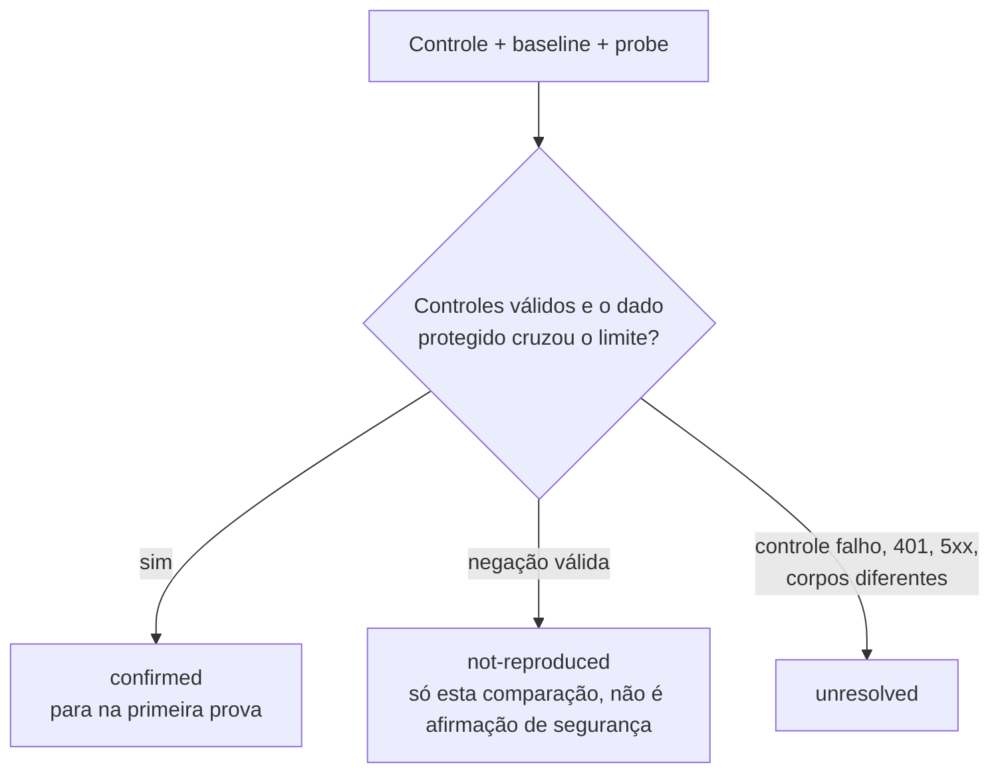
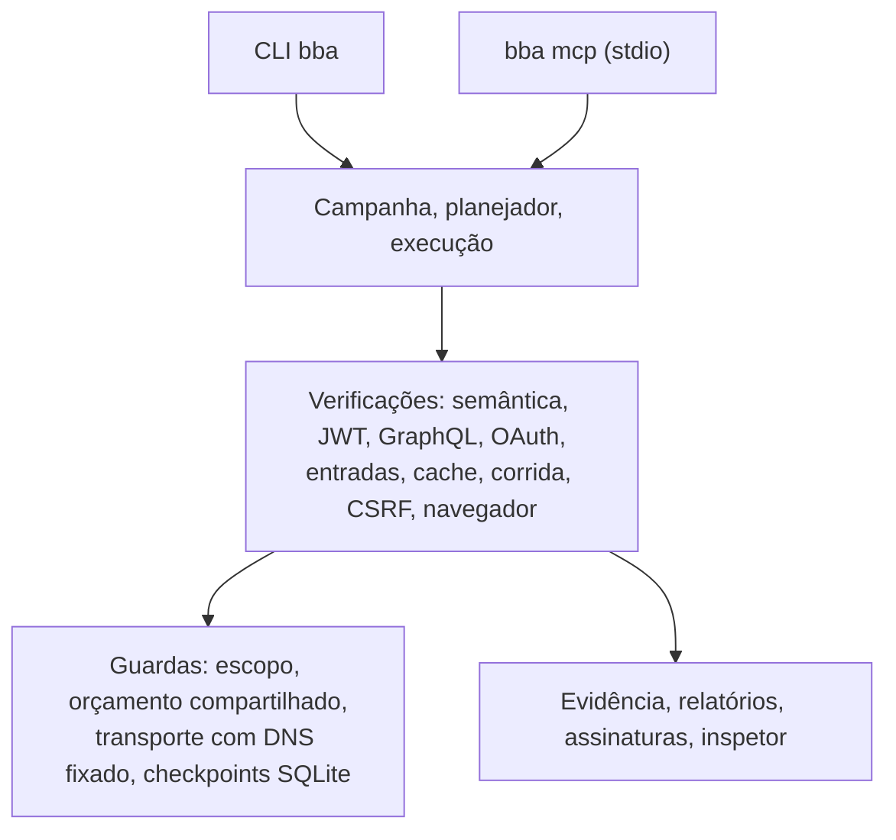

<div align="center">

[English](../../README.md) · [Español](README_es.md) · **Português (Brasil)** · [简体中文](README_zh.md)

# BBA: Bug Bounty Anything

### Uma skill de agente e um motor CLI/MCP locais para pesquisar vulnerabilidades com autorização e evidência verificável.

**Aponte seu agente para um serviço autorizado. Receba testes delimitados, prova reproduzível e um rascunho de relatório que você revisa.**

[](https://www.npmjs.com/package/bug-bounty-anything)
[](../../.github/workflows/ci.yml)
[](#requisitos)
[](../pt-BR/installation.md)
[](../../LICENSE)

[Início rápido](#início-rápido) · [Como o BBA funciona](#como-o-bba-funciona) · [O que você pode verificar](#o-que-você-pode-verificar) · [Exemplos](#exemplos) · [Perguntas frequentes](#perguntas-frequentes) · [Documentação](#documentação)

<code>npx --yes bug-bounty-anything@latest capabilities</code>

</div>

> [!IMPORTANT]
> Obtenha o BBA em [matiasdante/bug-bounty-anything](https://github.com/matiasdante/bug-bounty-anything)
> ou no [pacote npm bug-bounty-anything](https://www.npmjs.com/package/bug-bounty-anything).
> Um nome de repositório parecido ou um README copiado não comprova que um download seja oficial.
> O BBA é para serviços que você está autorizado a testar. Leia antes o [aviso de divulgação](../../DISCLOSURE).

---

Para um serviço autorizado, seu agente estabelece o escopo e a política do programa, prepara um caso, projeta a superfície de ataque, executa comparações delimitadas com contas que você controla e redige um relatório. Toda conclusão traz sua evidência e seus limites. O BBA nunca envia um relatório por conta própria.

Não é um scanner genérico. O agente conduz a investigação; o motor local fornece HTTP e Chromium delimitados, importadores offline, evidência persistente e verificações de autorização, entradas, cache, condições de corrida e navegador. Não encontrar uma vulnerabilidade confirmada é um resultado válido, e nunca se afirma mais cobertura do que foi executado.

A versão `2.0.0` unifica os comandos CLI e MCP, suporta Node.js `>=22.13.0` e `--lang es|en`, e inclui as verificações da [tabela abaixo](#o-que-você-pode-verificar). O [roadmap](../pt-BR/ROADMAP.md) registra cobertura e limites.

## Início rápido

### Requisitos

- Node.js **22.13.0 ou superior**, com npm. O Node fornece SQLite nativo. A única dependência de produção é `playwright-core` (Apache-2.0).
- Chromium, somente para captura e verificações de navegador: `npx playwright-core install --only-shell chromium`.
- Acesso loopback a `127.0.0.1` para os laboratórios locais e o inspetor.

### Configure seu agente

```bash
npm install --global bug-bounty-anything@latest
bba install-skill --out ~/.agents/skills/bug-bounty-anything
bba doctor
```

No PowerShell use `"$env:USERPROFILE/.agents/skills/bug-bounty-anything"`. O diretório de saída deve ser novo. Abra um novo chat se seu agente não atualizou o catálogo de skills. Mantenha o pacote onde foi instalado: `runtime.json` aponta para o runtime do Node e para a CLI compilada.

Para Claude Code, Codex ou Gemini CLI, você também pode gerar um ZIP portátil com `npm run package:skill -- --out dist-skill.zip` e descompactar `bug-bounty-anything` em `.claude/skills/` ou `~/.claude/skills/`. Para registrar o servidor MCP opcional, veja a prévia com `bba setup-mcp --root <workspace> --client claude` e depois acrescente `--apply`. Consulte [instalação e configuração](../pt-BR/installation.md).

### Peça ao seu agente

```text
$bug-bounty-anything investigate https://authorized-service/ and prepare findings
```

O agente consulta a política vigente do programa e cria os arquivos necessários. Só pergunta por fatos que não consegue estabelecer sozinho, como contas de teste ou uma regra de acesso. Sem autorização, interrompe os testes ativos naquele ativo; a pesquisa pública pode continuar.

### Use o terminal

Experimente o motor em um laboratório local descartável. Ele inicia um servidor em `127.0.0.1`, cria duas contas sintéticas e é encerrado ao terminar:

```bash
npx --yes bug-bounty-anything@latest lab --variant vulnerable --out runs/vulnerable
npx --yes bug-bounty-anything@latest lab --variant fixed --out runs/fixed
```

Depois trabalhe em um serviço autorizado com um arquivo de escopo:

```bash
bba prepare --scope scope.json --target https://authorized-service/ --out runs/investigation
bba investigate --scope scope.json --surface surface.json --profile profile.json --out runs/investigation
bba export-submission runs/investigation --platform hackerone --out runs/h1-draft.md
```

Se faltar política ou janela de autorização, `bba start-case --target <url> --out <diretório>` registra um caso pendente sem criar um escopo nem enviar requisições. Todos os comandos estão no [guia da CLI](../pt-BR/cli.md).

### Atualize o BBA

```bash
npm install --global bug-bounty-anything@latest
bba update-skill --out ~/.agents/skills/bug-bounty-anything
```

`update-skill` atualiza os arquivos gerenciados, mantém um backup em `.bba-backups/`, rejeita links para recursos e preserva arquivos alheios. Uma atualização interrompida nunca é informada como concluída.

## Como o BBA funciona

O agente resolve o alvo e a política vigente do programa e escreve um escopo que toda requisição posterior precisa cumprir. As verificações passam pelo transporte próprio do BBA, que aplica esse escopo e um orçamento compartilhado. Os resultados ficam como evidência redigida com cadeia de hashes, e o relatório é um rascunho para você.

```mermaid
flowchart LR
    U["Você: investigar<br/>um serviço autorizado"] --> A["Agente + skill BBA"]
    A --> P["1. Resolver o alvo,<br/>ler a política vigente"]
    P --> S["2. scope.json<br/>ativos, janela, limites"]
    S --> D["3. Descobrir a superfície<br/>captura, HAR, OpenAPI,<br/>REA, GraphQL, JS"]
    D --> H["4. Escolher hipóteses<br/>perfil com suas contas"]
    H --> C["5. Testes delimitados<br/>escopo + orçamento + transporte fixado"]
    C --> E["6. Evidência<br/>checkpoints SQLite,<br/>fatos redigidos, hashes"]
    E --> R["7. Rascunho do relatório<br/>você revisa e envia"]
```



Cada verificação compara um controle anônimo, uma linha de base e uma sonda, e retorna um de três resultados:



O diagrama abaixo mostra as camadas do motor. O [código-fonte da arquitetura](../architecture.mermaid) traz o mapa de módulos.



## O que você pode verificar

Cada linha exige caminhos e métodos autorizados, recursos que você controla e controles negativos. Uma classe documentada não é automaticamente um detector.

| Verificação                           | O que o BBA retorna                                                                              | Requisitos e guia                                                                                          |
| ------------------------------------- | ------------------------------------------------------------------------------------------------ | ---------------------------------------------------------------------------------------------------------- |
| BOLA, BFLA, exposição de propriedades | Resultado a partir de identidades do servidor, dados protegidos e controles anônimo/baseline/probe | Escopo, perfil, duas contas controladas; [investigação](../pt-BR/INVESTIGATION.md)                       |
| Isolamento de tenants, mass assignment | O mesmo, com estado antes/depois em recursos descartáveis                                       | Regras de negócio declaradas; [investigação](../pt-BR/INVESTIGATION.md)                                    |
| Caça autônoma a BOLA                  | Recursos HTML descobertos e verificados com duas contas                                          | Escopo vigente e regras de identidade/propriedade; [hunt](../pt-BR/HUNT.md)                                |
| Autorização GraphQL                   | Comparação de autorização por operação                                                           | Importação de introspecção ou SDL do GraphQL; [guia da CLI](../pt-BR/cli.md)                               |
| Integridade de JWT                    | Se claims alterados, `alg-none` ou tokens expirados ainda são aceitos                            | Um token de uma conta sua; [integridade de JWT](../pt-BR/JWT-INTEGRITY.md)                                 |
| OAuth `redirect_uri`, redirecionamentos | Classificação de `Location` 3xx, sem segui-la nem reter códigos                                | Rota de autorização dentro do escopo; [guia da CLI](../pt-BR/cli.md)                                       |
| XSS e CORS                            | Execução de marcador e leituras cross-origin reais no Chromium                                   | Chromium; [verificações de navegador](../pt-BR/BROWSER-CHECKS.md)                                          |
| Fluxos de navegador                   | Cenários declarados de navegação, formulários e rotação de cookies em contexto efêmero           | Chromium; [cenários](../pt-BR/SCENARIOS.md)                                                                |
| Expressão de template, callback de URL | Avaliação da sintaxe `a*b`; requisição de saída para um receptor seu                            | Regras exatas de escopo; [provas de entrada](../pt-BR/INPUT-PROOFS.md)                                     |
| Cache, corrida, CSRF                  | Exposição correlacionada ao cache, uso duplo de operação única, formulário cross-origin sobre estado próprio | Recursos próprios; [cache](../pt-BR/CACHE-CHECK.md), [corrida](../pt-BR/RACE-CHECK.md), [CSRF](../pt-BR/CSRF-CHECK.md) |
| Importar superfície (offline)         | Endpoints de HAR 1.2, OpenAPI/Swagger, evidência REA, GraphQL, bundles JS e SourceMap            | Nenhum; `import-surface`; [guia da CLI](../pt-BR/cli.md#importar-superfície-e-política)                    |
| Importar políticas e scanners (offline) | HackerOne, Bugcrowd, Intigriti, `security.txt`; resultados de ZAP, Nuclei, Subfinder, sempre `unvalidated` | Nenhum; o BBA não executa esses scanners; [guia da CLI](../pt-BR/cli.md)                      |
| Estudos de casos publicados           | Uma classe de bug publicada reproduzida como um candidato delimitado                             | Política vigente e conta própria; [casos publicados](../pt-BR/PUBLISHED-CASE-STUDIES.md)                   |
| Evidência e relatórios                | Fatos redigidos, assinaturas Ed25519, rascunhos de envio, inspetor somente leitura               | Nenhum; [guia da CLI](../pt-BR/cli.md#assinaturas-rascunhos-de-envio-e-inspetor-local)                     |

Execute `bba capabilities` para ver a lista autoritativa do que a versão instalada confirma, apenas importa ou não suporta.

## Exemplos

### Laboratório vulnerável e corrigido

O laboratório cria duas contas sintéticas com um documento privado cada, envia cinco GET sequenciais e decide a partir das respostas e dos controles, não do nome da variante.

```text
$ bba lab --variant vulnerable --out runs/vulnerable
{ "variant": "vulnerable", "requests": 5, "confirmed": 2, "notReproduced": 0, "unresolved": 0 }

$ bba lab --variant fixed --out runs/fixed
{ "variant": "fixed", "requests": 5, "confirmed": 0, "notReproduced": 2, "unresolved": 0 }
```

| Requisição                    | Vulnerável                 | Corrigida |
| ----------------------------- | -------------------------- | --------- |
| Anônimo lê o documento B      | 401                        | 401       |
| A lê o documento A            | 200                        | 200       |
| B lê o documento B            | 200                        | 200       |
| A lê o documento B            | 200 e conteúdo de B        | 403       |
| B lê o documento A            | 200 e conteúdo de A        | 403       |

`inspect` e `report` leem a evidência salva sem rede. A variante vulnerável mostra duas direções de uma mesma causa raiz, não duas vulnerabilidades independentes, e nenhuma severidade de produção é inferida.

```bash
bba inspect runs/vulnerable
bba report runs/vulnerable --out runs/vulnerable-export.md
```

### Integridade da assinatura JWT na sua própria conta

Quatro requisições a um endpoint: anônima, token original, token com um claim alterado e a assinatura antiga, e o token original de novo. `confirmed` exige negação anônima e o mesmo dado protegido próprio com ambos os tokens.

```bash
export BBA_TOKEN_OWNED='<JWT assinado da sua própria conta de teste>'
export BBA_BODY_QUERY='{"query":"SELECT 1","tableName":"OwnedTestData","rowLimit":1}'
bba jwt-check --scope scope.json --config jwt-check.json --out runs/jwt-check
```

[Leia o contrato](../pt-BR/JWT-INTEGRITY.md) · [Casos publicados](../pt-BR/PUBLISHED-CASE-STUDIES.md)

### Dossiê de campanha para um alvo

Abra um caso, vincule escopo e revisão de política, capture ou importe a superfície, vincule um perfil com duas identidades controladas e execute uma vez com orçamento compartilhado. O trabalho interrompido é retomado sem repetir etapas registradas.

```bash
bba campaign-open --target https://authorized-service/ --out runs/case
bba campaign-status runs/case
bba campaign-execute runs/case
```

[Leia o guia de campanhas](../pt-BR/CAMPAIGNS.md) · [Núcleo de execução](../pt-BR/EXECUTION.md)

## Perguntas frequentes

<details>
<summary><strong>Quais agentes podem usar o BBA?</strong></summary>

Qualquer agente que carregue skills de uma pasta: o instalador e o empacotador cobrem Claude Code, Codex e Gemini CLI. O servidor MCP opcional (`bba mcp`) funciona com clientes que suportam servidores stdio locais; `setup-mcp` o registra para Codex, Claude ou Gemini.

</details>

<details>
<summary><strong>Preciso de MCP?</strong></summary>

Não. A skill funciona pela CLI. O registro MCP expõe apenas ferramentas offline até você passar `--allow-network`, e os caminhos ficam confinados a `--root`.

</details>

<details>
<summary><strong>O BBA é um scanner de vulnerabilidades?</strong></summary>

Não. Ele não faz crawling, não faz fuzzing e não executa ZAP, Nuclei ou Subfinder; importa a saída deles offline como candidatos não validados. As verificações ativas são comparações específicas que exigem escopo declarado, contas que você controla e controles negativos.

</details>

<details>
<summary><strong>O que significa uma verificação ser `confirmed`?</strong></summary>

A regra declarada foi violada para a conta, rota e campo exatos que foram testados, e os controles se sustentaram. Não é uma severidade, nem uma afirmação sobre outras rotas, nem prova de impacto. `not-reproduced` exclui apenas aquela comparação, e `unresolved` significa que os controles não estabeleceram um resultado.

</details>

<details>
<summary><strong>O BBA contata serviços sem permissão?</strong></summary>

`scope-check` valida formato, janela e correspondência de destino; não verifica a permissão do dono. O agente ou você devem estabelecer a permissão e as regras vigentes do programa antes de escrever um escopo. Uma URL de política, `security.txt` ou o interesse do usuário não são autorização.

</details>

<details>
<summary><strong>O BBA envia meus dados ou relatórios?</strong></summary>

A análise roda localmente. As credenciais vêm de variáveis de ambiente e nunca são persistidas. Seu agente recebe os resultados das ferramentas, e o provedor do modelo tem sua própria política de dados. O BBA nunca envia um relatório; `export-submission` escreve um rascunho em Markdown para você revisar.

</details>

<details>
<summary><strong>Preciso do Chromium?</strong></summary>

Somente para `capture`, `browser-check` e `browser-scenario`. Instale-o à parte com `npx playwright-core install --only-shell chromium`. Os demais comandos não precisam dele.

</details>

<details>
<summary><strong>O que fazer ao encontrar um bug?</strong></summary>

Atualize primeiro; uma versão recente pode já ter corrigido. Execute `bba doctor`, tente de novo e, se persistir, [abra uma issue](https://github.com/matiasdante/bug-bounty-anything/issues) com as versões do BBA e do Node, o comando e a saída de erro. Nunca inclua tokens, cookies nem dados do alvo.

</details>

<details>
<summary><strong>O que ainda não é coberto?</strong></summary>

Login/SSO e inferência dinâmica de tokens, confirmação de mais classes de vulnerabilidade e execução confinada de scanners. Os cenários declarados de formulários/ações e a rotação de cookies em memória funcionam hoje, mas não podem ser retomados após uma queda. A geração semântica e as verificações XSS/CORS têm cobertura GET delimitada. Veja o [roadmap](../pt-BR/ROADMAP.md).

</details>

## Documentação

Para opções exatas, pré-requisitos e contratos de resultado:

- [Instalação e configuração](../pt-BR/installation.md): skill, npm, diagnóstico e registro MCP.
- [Guia da CLI](../pt-BR/cli.md): execução com escopo, importações, captura, avaliação, assinaturas, cabeçalhos e limites.
- [Núcleo de execução](../pt-BR/EXECUTION.md): contratos de scope e plano, checkpoints e recuperação.
- [Investigação e evidência](../pt-BR/INVESTIGATION.md): classes semânticas, fatos e orçamento entre fases.
- [Campanhas](../pt-BR/CAMPAIGNS.md), [hunt autônomo](../pt-BR/HUNT.md) e [casos publicados](../pt-BR/PUBLISHED-CASE-STUDIES.md).
- Verificações: [JWT](../pt-BR/JWT-INTEGRITY.md), [navegador](../pt-BR/BROWSER-CHECKS.md), [cenários](../pt-BR/SCENARIOS.md), [provas de entrada](../pt-BR/INPUT-PROOFS.md), [cache](../pt-BR/CACHE-CHECK.md), [corrida](../pt-BR/RACE-CHECK.md), [CSRF](../pt-BR/CSRF-CHECK.md).
- [Modelo de dados persistente](../pt-BR/database.md) e [mapa de arquitetura](../architecture.mermaid).
- [Roadmap](../pt-BR/ROADMAP.md): cronologia, evidência e limites restantes.
- Instruções do agente: [SKILL.md](../../SKILL.md) e [referências](../../references/).

A documentação também está em [English](../), [Español](../es/) e [简体中文](../zh/).

## Aviso legal

Veja [DISCLOSURE](../../DISCLOSURE) para orientações de uso responsável.

O BBA é para pesquisa em programas de bug bounty, testes de intrusão e validação defensiva com autorização do dono do ativo e sob as regras vigentes do programa. Quem opera é responsável por obter autorização, respeitar exclusões e limites de taxa e revisar os achados antes de divulgá-los. As métricas de laboratório não estimam taxas reais de detecção nem de falsos positivos e não provam que um alvo seja seguro.

## Contribuindo

Sua ajuda com o BBA é bem-vinda! [Abra uma issue](https://github.com/matiasdante/bug-bounty-anything/issues) para relatar um bug ou sugerir uma melhoria, ou envie um pull request.

Ambiente de desenvolvimento: `npm install` e depois `npm run verify` (verificação estrita de TypeScript, build e testes). Os testes usam servidores HTTP locais reais e nunca contatam serviços de produção. O CI roda em Ubuntu e Windows com Node 22.13 e 24. Os códigos de saída estão no [guia da CLI](../pt-BR/cli.md#verificação).

## Licença

[MIT](../../LICENSE)
