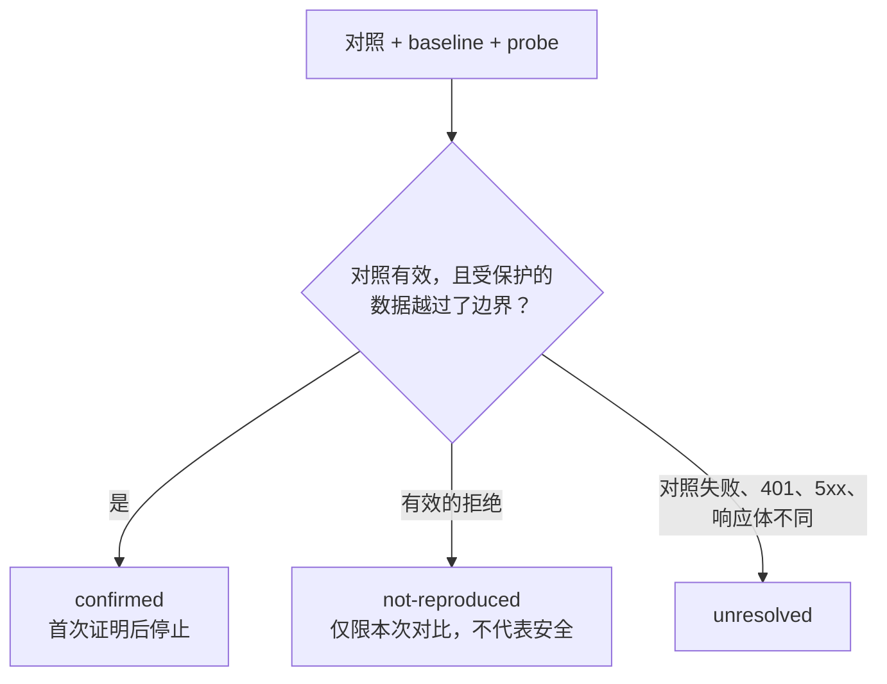
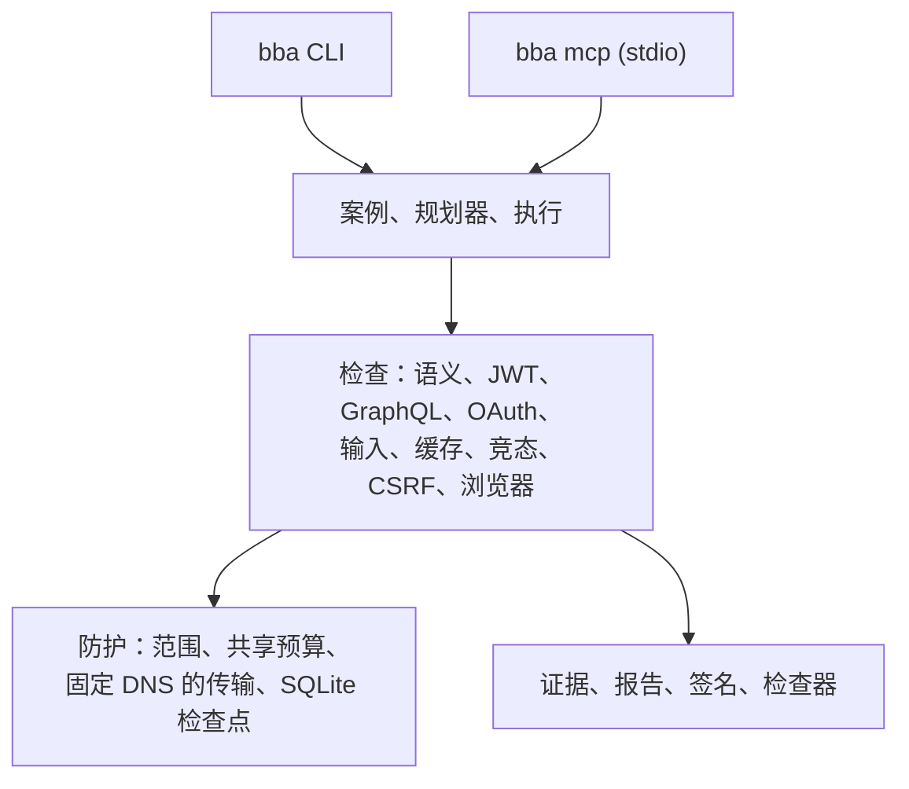

<div align="center">

[English](../../README.md) · [Español](README_es.md) · [Português (Brasil)](README_pt-BR.md) · **简体中文**

# BBA：Bug Bounty Anything

### 本地运行的智能体技能与 CLI/MCP 引擎，在获得授权的前提下研究漏洞并留下可验证的证据。

**让你的智能体面向已授权的服务工作：有边界的检查、可复现的证明，以及由你审阅的报告草稿。**

[](https://www.npmjs.com/package/bug-bounty-anything)
[](../../.github/workflows/ci.yml)
[](#环境要求)
[](../zh/installation.md)
[](../../LICENSE)

[快速开始](#快速开始) · [BBA 如何工作](#bba-如何工作) · [可以检查什么](#可以检查什么) · [示例](#示例) · [常见问题](#常见问题) · [文档](#文档)

<code>npx --yes bug-bounty-anything@latest capabilities</code>

</div>

> [!IMPORTANT]
> 请从 [matiasdante/bug-bounty-anything](https://github.com/matiasdante/bug-bounty-anything)
> 或 [bug-bounty-anything npm 包](https://www.npmjs.com/package/bug-bounty-anything) 获取 BBA。
> 名称相近的仓库或被复制的 README 并不能证明某个下载是官方版本。
> BBA 仅用于你已获授权测试的服务。请先阅读[披露声明](../../DISCLOSURE)。

---

对于已授权的服务，你的智能体会确认范围与项目政策、准备案例、推演攻击面、用你控制的账号执行有边界的对比，并起草报告。每个结论都附带证据和局限。BBA 绝不会自行提交报告。

它不是通用扫描器。智能体负责推进调查；本地引擎提供有边界的 HTTP 与 Chromium 检查、离线导入器、持久化证据，以及针对授权、输入、缓存、竞态和浏览器行为的检查。没有发现已确认的漏洞同样是有效结果，且绝不声称超出实际执行范围的覆盖率。

`2.0.0` 版本统一了 CLI 与 MCP 命令，支持 Node.js `>=22.13.0` 和 `--lang es|en`，并新增了[下表](#可以检查什么)中的检查。[路线图](../zh/ROADMAP.md)记录了覆盖范围与局限。

## 快速开始

### 环境要求

- Node.js **22.13.0 或更高版本**，以及 npm。Node 提供原生 SQLite。唯一的生产依赖是 `playwright-core`（Apache-2.0）。
- Chromium，仅用于抓取和浏览器检查：`npx playwright-core install --only-shell chromium`。
- 本地实验环境和检查器需要访问 `127.0.0.1` 回环地址。

### 配置你的智能体

```bash
npm install --global bug-bounty-anything@latest
bba install-skill --out ~/.agents/skills/bug-bounty-anything
bba doctor
```

在 PowerShell 中使用 `"$env:USERPROFILE/.agents/skills/bug-bounty-anything"`。输出目录必须是新目录。如果智能体尚未刷新技能目录，请开启新的对话。请让包保持在安装位置：`runtime.json` 指向其 Node 运行时和已编译的 CLI。

对于 Claude Code、Codex 或 Gemini CLI，也可以用 `npm run package:skill -- --out dist-skill.zip` 生成可移植的 ZIP，并把 `bug-bounty-anything` 解压到 `.claude/skills/` 或 `~/.claude/skills/`。要注册可选的 MCP 服务器，先用 `bba setup-mcp --root <workspace> --client claude` 预览，再加上 `--apply`。详见[安装与配置](../zh/installation.md)。

### 向智能体提问

```text
$bug-bounty-anything investigate https://authorized-service/ and prepare findings
```

智能体会查阅项目当前的政策并创建所需文件。它只会询问自己无法确定的事实，例如测试账号或访问规则。没有授权时，它会停止对该资产的主动检查；公开资料研究可以继续。

### 使用终端

先在一次性本地实验环境中试用引擎。它会在 `127.0.0.1` 启动服务器、创建两个合成账号，并在结束时关闭：

```bash
npx --yes bug-bounty-anything@latest lab --variant vulnerable --out runs/vulnerable
npx --yes bug-bounty-anything@latest lab --variant fixed --out runs/fixed
```

然后使用范围文件处理已授权的服务：

```bash
bba prepare --scope scope.json --target https://authorized-service/ --out runs/investigation
bba investigate --scope scope.json --surface surface.json --profile profile.json --out runs/investigation
bba export-submission runs/investigation --platform hackerone --out runs/h1-draft.md
```

如果缺少政策或授权时间窗口，`bba start-case --target <url> --out <目录>` 会记录一个待定案例，不会创建范围，也不会发送请求。全部命令见 [CLI 指南](../zh/cli.md)。

### 更新 BBA

```bash
npm install --global bug-bounty-anything@latest
bba update-skill --out ~/.agents/skills/bug-bounty-anything
```

`update-skill` 会更新受管文件，在 `.bba-backups/` 中保留备份，拒绝资源链接，并保留无关文件。被中断的更新绝不会被报告为已完成。

## BBA 如何工作

智能体先确定目标和项目当前的政策，再写出一个范围文件，之后的每个请求都必须符合它。检查通过 BBA 自己的传输层发送，该层强制执行范围和共享预算。结果以脱敏、带哈希链的证据保存，报告只是留给你的草稿。


每项检查都会比较匿名对照、基线和探测，并给出三种结果之一：



下图展示了引擎的分层。模块映射见[架构源文件](../architecture.mermaid)。



## 可以检查什么

每一行都需要已授权的路径和方法、你自己控制的资源以及负向对照。文档中列出的某个类别并不自动等于一个检测器。

| 检查                          | BBA 返回的内容                                                       | 要求与指南                                                                                  |
| ----------------------------- | -------------------------------------------------------------------- | ------------------------------------------------------------------------------------------- |
| BOLA、BFLA、属性暴露          | 基于服务器返回的身份、受保护数据以及匿名/baseline/probe 对照得出的结果 | 范围、配置、两个受控账号；[调查](../zh/INVESTIGATION.md)                                    |
| 租户隔离、批量赋值            | 同上，并在一次性资源上比对前后状态                                   | 已声明的业务规则；[调查](../zh/INVESTIGATION.md)                                            |
| 自主 BOLA 搜寻                | 用两个账号检查发现的 HTML 资源                                       | 当前范围及身份/归属规则；[hunt](../zh/HUNT.md)                                              |
| GraphQL 授权                  | 按操作进行的授权对比                                                 | 导入 GraphQL 内省或 SDL；[CLI 指南](../zh/cli.md)                                           |
| JWT 完整性                    | 被修改的 claim、`alg-none` 或过期令牌是否仍被接受                    | 你自己账号的令牌；[JWT 完整性](../zh/JWT-INTEGRITY.md)                                      |
| OAuth `redirect_uri`、重定向  | 对 3xx `Location` 分类，不跟随、不保留授权码                         | 范围内的授权路由；[CLI 指南](../zh/cli.md)                                                  |
| XSS 与 CORS                   | 在 Chromium 中执行标记并进行真实的跨源读取                           | Chromium；[浏览器检查](../zh/BROWSER-CHECKS.md)                                             |
| 浏览器流程                    | 在临时上下文中执行已声明的导航、表单和 Cookie 轮换场景               | Chromium；[场景](../zh/SCENARIOS.md)                                                        |
| 模板表达式、URL 回调          | 对 `a*b` 语法的求值；向你自己的接收端发出的外联请求                  | 精确的范围规则；[输入证明](../zh/INPUT-PROOFS.md)                                           |
| 缓存、竞态、CSRF              | 与缓存相关的暴露、一次性操作的重复使用、针对自有状态的跨源表单       | 自有资源；[缓存](../zh/CACHE-CHECK.md)、[竞态](../zh/RACE-CHECK.md)、[CSRF](../zh/CSRF-CHECK.md) |
| 导入攻击面（离线）            | 来自 HAR 1.2、OpenAPI/Swagger、REA 证据、GraphQL、JS bundle 和 SourceMap 的端点 | 无；`import-surface`；[CLI 指南](../zh/cli.md)                                  |
| 导入政策与扫描器结果（离线）  | HackerOne、Bugcrowd、Intigriti、`security.txt`；ZAP、Nuclei、Subfinder 结果，始终为 `unvalidated` | 无；BBA 不会运行这些扫描器；[CLI 指南](../zh/cli.md)                    |
| 已发表案例研究                | 把已发表的漏洞类别重现为一个有边界的候选项                           | 当前政策和自有账号；[案例研究](../zh/PUBLISHED-CASE-STUDIES.md)                             |
| 证据与报告                    | 脱敏事实、Ed25519 签名、提交草稿、只读检查器                         | 无；[CLI 指南](../zh/cli.md)                                                                |

运行 `bba capabilities` 可获得权威清单，列出已安装版本能确认、仅导入或不支持的内容。

## 示例

### 存在漏洞与已修复的实验环境

实验环境会创建两个合成账号，各有一份私有文档，发送五个顺序 GET 请求，并根据响应和对照作出判断，而不是依据变体名称。

```text
$ bba lab --variant vulnerable --out runs/vulnerable
{ "variant": "vulnerable", "requests": 5, "confirmed": 2, "notReproduced": 0, "unresolved": 0 }

$ bba lab --variant fixed --out runs/fixed
{ "variant": "fixed", "requests": 5, "confirmed": 0, "notReproduced": 2, "unresolved": 0 }
```

| 请求                | 存在漏洞版本          | 已修复版本 |
| ------------------- | --------------------- | ---------- |
| 匿名读取文档 B      | 401                   | 401        |
| A 读取文档 A        | 200                   | 200        |
| B 读取文档 B        | 200                   | 200        |
| A 读取文档 B        | 200，返回 B 的内容    | 403        |
| B 读取文档 A        | 200，返回 A 的内容    | 403        |

`inspect` 和 `report` 无需联网即可读取已保存的证据。存在漏洞的版本展示的是同一根因的两个方向，而不是两个独立漏洞，也不会推断生产环境的严重程度。

```bash
bba inspect runs/vulnerable
bba report runs/vulnerable --out runs/vulnerable-export.md
```

### 在你自己的账号上检查 JWT 签名完整性

向同一端点发送四个请求：匿名请求、原始令牌、修改了 claim 但沿用旧签名的令牌，以及再次使用原始令牌。只有在匿名请求被拒绝，并且两个令牌都能取得同一个自有受保护事实时，才会得到 `confirmed`。

```bash
export BBA_TOKEN_OWNED='<你自己测试账号的已签名 JWT>'
export BBA_BODY_QUERY='{"query":"SELECT 1","tableName":"OwnedTestData","rowLimit":1}'
bba jwt-check --scope scope.json --config jwt-check.json --out runs/jwt-check
```

[阅读契约](../zh/JWT-INTEGRITY.md) · [已发表案例研究](../zh/PUBLISHED-CASE-STUDIES.md)

### 针对单个目标的案例档案

创建案例，关联范围与政策审阅，抓取或导入攻击面，关联包含两个受控身份的配置，然后在共享预算下执行一次。被中断的工作可以恢复，且不会重复已记录的步骤。

```bash
bba campaign-open --target https://authorized-service/ --out runs/case
bba campaign-status runs/case
bba campaign-execute runs/case
```

[阅读案例档案指南](../zh/CAMPAIGNS.md) · [执行核心](../zh/EXECUTION.md)

## 常见问题

<details>
<summary><strong>哪些智能体可以使用 BBA？</strong></summary>

任何能从文件夹加载技能的智能体：安装器和打包器覆盖 Claude Code、Codex 和 Gemini CLI。可选的 MCP 服务器（`bba mcp`）适用于支持本地 stdio 服务器的客户端；`setup-mcp` 可为 Codex、Claude 或 Gemini 注册它。

</details>

<details>
<summary><strong>我需要 MCP 吗？</strong></summary>

不需要。技能通过 CLI 即可工作。MCP 注册默认只暴露离线工具，直到你传入 `--allow-network`，且路径被限制在 `--root` 之内。

</details>

<details>
<summary><strong>BBA 是漏洞扫描器吗？</strong></summary>

不是。它不会爬取站点、不做模糊测试，也不会运行 ZAP、Nuclei 或 Subfinder；它只离线导入这些工具的输出，作为未经验证的候选项。主动检查是特定的对比，需要已声明的范围、你控制的账号以及负向对照。

</details>

<details>
<summary><strong>检查结果为 `confirmed` 意味着什么？</strong></summary>

在所测试的确切账号、路由和字段上，已声明的规则被违反，且对照成立。它不是严重程度，不代表其他路由，也不是影响的证明。`not-reproduced` 仅排除该次对比，`unresolved` 表示对照未能得出结果。

</details>

<details>
<summary><strong>BBA 会在未经许可的情况下联系服务吗？</strong></summary>

`scope-check` 验证格式、时间窗口和目标匹配，但不会核实所有者的许可。在写出范围文件之前，智能体或你必须先确认许可和项目当前的规则。政策的 URL、`security.txt` 或用户的兴趣本身都不构成授权。

</details>

<details>
<summary><strong>BBA 会上传我的数据或提交报告吗？</strong></summary>

分析在本地运行。凭据来自环境变量，绝不会被持久化。你的智能体会收到工具结果，其模型提供方有自己的数据政策。BBA 从不提交报告；`export-submission` 只会写出供你审阅的 Markdown 草稿。

</details>

<details>
<summary><strong>我需要 Chromium 吗？</strong></summary>

只有 `capture`、`browser-check` 和 `browser-scenario` 需要。请用 `npx playwright-core install --only-shell chromium` 单独安装。其他命令不需要它。

</details>

<details>
<summary><strong>遇到 bug 怎么办？</strong></summary>

先更新；新版本可能已经修复。运行 `bba doctor` 后重试，若问题仍在，请[提交 issue](https://github.com/matiasdante/bug-bounty-anything/issues)，附上 BBA 和 Node 的版本、命令及错误输出。切勿包含令牌、Cookie 或目标数据。

</details>

<details>
<summary><strong>目前还有哪些未覆盖？</strong></summary>

登录/SSO 与动态令牌推断、更多漏洞类别的确认，以及受限的扫描器执行。已声明的表单/动作场景和内存中的 Cookie 轮换现在可以运行，但崩溃后无法恢复。语义生成以及 XSS/CORS 检查只覆盖有边界的 GET。详见[路线图](../zh/ROADMAP.md)。

</details>

## 文档

确切的选项、前置条件和结果契约：

- [安装与配置](../zh/installation.md)：技能、npm、诊断与 MCP 注册。
- [CLI 指南](../zh/cli.md)：带范围的执行、导入、抓取、评估、签名、请求头与限制。
- [执行核心](../zh/EXECUTION.md)：scope 与计划契约、检查点与恢复。
- [调查与证据](../zh/INVESTIGATION.md)：语义类别、事实与跨阶段预算。
- [案例档案](../zh/CAMPAIGNS.md)、[自主 hunt](../zh/HUNT.md) 和[已发表案例研究](../zh/PUBLISHED-CASE-STUDIES.md)。
- 检查：[JWT](../zh/JWT-INTEGRITY.md)、[浏览器](../zh/BROWSER-CHECKS.md)、[场景](../zh/SCENARIOS.md)、[输入证明](../zh/INPUT-PROOFS.md)、[缓存](../zh/CACHE-CHECK.md)、[竞态](../zh/RACE-CHECK.md)、[CSRF](../zh/CSRF-CHECK.md)。
- [持久化数据模型](../zh/database.md)和[架构图](../architecture.mermaid)。
- [路线图](../zh/ROADMAP.md)：时间线、证据与剩余局限。
- 智能体指令：[SKILL.md](../../SKILL.md) 和[参考资料](../../references/)。

文档还提供 [English](../)、[Español](../es/) 和 [Português (Brasil)](../pt-BR/) 版本。

## 免责声明

负责任使用的指引见 [DISCLOSURE](../../DISCLOSURE)。

BBA 用于漏洞赏金研究、渗透测试和防御性验证，须取得资产所有者的授权并遵守项目当前的规则。操作者有责任取得授权、遵守排除项和速率限制，并在披露前审阅发现。实验环境的指标不能用来估计真实世界的检出率或误报率，也不能证明目标是安全的。

## 贡献

欢迎帮助改进 BBA！[提交 issue](https://github.com/matiasdante/bug-bounty-anything/issues) 报告 bug 或提出建议，也可以发送 pull request。

开发环境：`npm install`，然后运行 `npm run verify`（严格的 TypeScript 检查、构建和测试）。测试使用真实的本地 HTTP 服务器，绝不会联系生产服务。CI 在 Ubuntu 和 Windows 上使用 Node 22.13 和 24 运行。退出码见 [CLI 指南](../zh/cli.md)。

## 许可证

[MIT](../../LICENSE)
