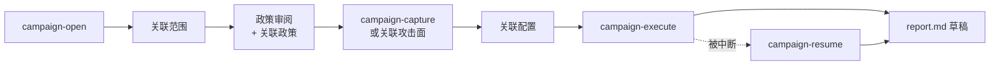

# 案例档案 (1.9.0)

[English](../CAMPAIGNS.md) · [Español](../es/CAMPAIGNS.md) · [Português (Brasil)](../pt-BR/CAMPAIGNS.md) · **简体中文**

案例档案（campaign）协调针对单个目标的研究：范围来源、政策审阅、攻击面、自有账号配置、执行和草稿。各个关联会记录在带哈希链的日志中。`campaign_status` 会重新验证文件，并显示预算和下一步。它能发现意外的改动或不一致；但它不认证政策的所有者，也不会把一次观察变成发现。



## 创建与授权

1. `campaign_open` / `campaign-open --target <url> --out <新目录>` 创建案例，不发送请求。目标必须是规范化的 URL。
2. 在案例中写入 `scope.json`，包含稳定的 `budgetId`、当前有效的授权时间窗口、精确的资产/路由/方法、限制以及授权引用。`campaign_link --kind scope` 会检查目标是否被覆盖，并为该案例冻结此范围。
3. 阅读当前官方的项目政策，或所有者的书面许可。将文本副本保存为 `policy-source.txt`。`campaign-policy-review` / `campaign_policy_review` 会生成 `policy.json`，把来源的 SHA-256 与范围以及操作者的明确决定绑定在一起。使用 `campaign-link --kind policy` 审阅并关联它。没有本地副本的历史形式仍然被接受：

```json
{
  "schemaVersion": 1,
  "sourceUrl": "https://program.example/policy",
  "reviewedAt": "2026-10-30T12:00:00.000Z",
  "scopeDigest": "<规范化范围的 SHA-256>",
  "authorizationReference": "<与 scope.authorization.reference 相同>",
  "sourceKind": "official-program-policy",
  "operatorDecision": "authorized"
}
```

如果无法确立许可，请选择 `uncertain`。这记录的是人的决定；工具不会获取或验证政策。仅有政策 URL、`security.txt` 或用户的兴趣，并不授权主动测试。`campaign_status` 会报告 `policySourceBound` 并检测本地副本的改动。其哈希只表明副本的完整性，而不表明来源的真实性或所有者的许可；请保留链接和查阅日期。

## MCP 与 CLI 流程

启用 MCP `--allow-network` 后，`campaign_capture` 会用有边界的 GET **对精确的目标 URL 抓取一次**。它在 `actions/capture/output` 下写入 `pages.json`、`capture.json` 和 `surface.json`，并关联观察到的页面和攻击面事实。DOM 路径只是线索，绝不会被自动访问或加入范围。CLI：`bba campaign-capture <案例>`。

也可以改用 `campaign_link --kind surface` 关联 OpenAPI、Swagger、HAR 或 REA 的攻击面包。用 `--kind profile` 关联包含两个受控身份和明确业务规则的调查配置。`campaign_status` 会显示已编译的语义检查数量，以及未覆盖的类别/条目。新的配置可以跟随新的攻击面；旧的修订保留在历史中。

`campaign_execute` / `bba campaign-execute <案例>` 在共享范围预算下，**对每个当前配置**执行一次匿名、所有者和其他账号的对照。它在第一个已确认的语义证明处停止。运行结果和 `report.md` 保存在 `actions/investigation-<序号>/output` 下，并在完成或在 `proof-complete` 处停止时关联。凭据来自 MCP 环境中的 `BBA_TOKEN_*` 或 `BBA_COOKIE_*`，绝不来自参数或案例文件。提交草稿前请审阅影响、复现步骤和披露规则。

## 停止与恢复

动作目录会在发送请求前预留。如果抓取/调查被中断，`campaign_status` 会显示 `interrupted-action`，并且不会重新运行它。请检查 `started.json`、输出和 `inspect_budget`。不确定的预留或过期的时间窗口会阻止新的动作。`campaign_resume` / `bba campaign-resume <案例>` 会把当前的范围、攻击面和配置与暂停时的检查点对比，只恢复尚未开始的步骤，写入 `report-resumed.md`，并关联已完成的产物。已有报告的终态运行会被直接关联，不再发送请求。浏览器抓取没有自动恢复。

语义草稿会分别说明问题、发现、证明、复现和修复。证明保留每项检查的确切状态和证据 ID；`unresolved` 绝不会变成声称的影响。日志上限为 100 个事件，路径被限制在案例目录内。目前的自动检查覆盖在已声明的身份和业务规则下对 JSON GET 进行的 BOLA、BFLA、属性暴露和租户隔离。其他向量需要各自的工具，否则仍是空白。案例档案不声称存在严重漏洞，也不声称完整覆盖攻击面。
