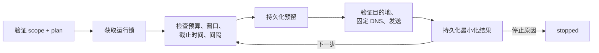
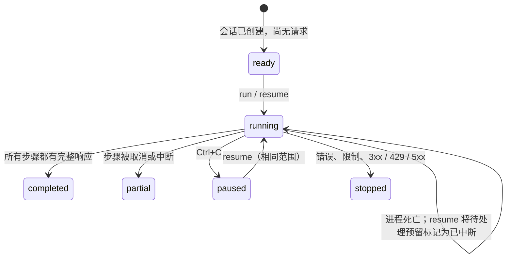

# 执行核心

[English](../EXECUTION.md) · [Español](../es/EXECUTION.md) · [Português (Brasil)](../pt-BR/EXECUTION.md) · **简体中文**

该核心在由代码校验的范围下运行有限的 HTTP 计划，并跨进程持久化各次尝试。HTTP 响应只是观察结果；[语义检查](INVESTIGATION.md)和[浏览器检查](BROWSER-CHECKS.md)有各自的确认标准。`lab` 保留其原有的产物格式。

## 准备范围

[src/scope.ts](../../src/scope.ts) 负责验证该契约。`scope-check` 是离线的：它不读取远程政策，也不会把书面引用变成许可。执行前请核实真实的权限、允许的技术，以及每个 GET 的安全影响。

| 字段 | 要求 |
|---|---|
| `schemaVersion` | `1` |
| `mode` | `loopback-lab`：对显式端口的 `127.0.0.1` 使用 HTTP；`public-https`：对允许的公网地址使用 HTTPS |
| `authorization` | 不含机密的 `reference`，UTC ISO 格式的 `validFrom` / `validUntil` |
| `allowed`、`excluded` | `{ origin, paths }`，精确匹配，无通配符；排除项优先 |
| `requestHeaders` | 可选，按来源的 `{ origin, name, valueEnv }`；小写的 `user-agent` 或 `x-*`，值来自 `BBA_HEADER_*` |
| `requestRules` | 可选，在允许路径内的精确 `{ origin, path, method, queryNames, bodyFormats }` |
| `budgetId` | 旧范围可选；新范围应在各阶段之间共享预算，并存放在规范范围文件旁 |
| `limits.maxRequests` | 整个调查中共 1–100 次尝试 |
| `limits.minIntervalMs` | 一次尝试结束到下一次开始之间 0–60000 毫秒 |
| `limits.timeoutMs` | 含 DNS 和读取在内 1–60000 毫秒 |
| `limits.maxResponseBytes` | 每个响应体 1 字节–1 MiB |
| `limits.maxDurationMs` | 自创建起 1 毫秒–24 小时，包含暂停 |

URL 必须是规范化的：不含查询、片段、内嵌凭据、百分号转义、被规范化的路径段或有歧义的路径。切勿在引用、ID 或路径中放入机密或个人数据，它们会作为元数据保存。完整范围按摘要冻结；即使要延长有效期也需要新的调查。默认只允许不带查询/请求体的 GET。`requestRules` 可以显式允许 GET、HEAD、OPTIONS、POST、PUT、PATCH、DELETE、选定的查询参数名和请求体格式。请审阅每个会改变状态的操作，使用受控资源，并规划清理。重定向、路径转义、通配符以及 URL 内嵌的查询仍然被阻止。规则示例：`{ "origin": "https://service.example", "path": "/api/search", "method": "POST", "queryNames": ["page"], "bodyFormats": ["json"] }`。GET/HEAD 绝不接受请求体。

用于标识的 `requestHeaders` 不是认证，也不是伪造测试。每个来源/名称组合必须唯一；值为 1–512 个可打印 ASCII 字符，在执行前解析，并从证据中丢弃。缺失的值、CR/LF 以及认证/传输类名称都会被阻止。浏览器请求遵循同样的来源规则。更改引用会改变范围摘要，也无法悄悄改变一次已恢复的运行。`prepare --scope scope.json --target <精确-url> --out <新目录>` 会离线写出案例、范围副本、初始计划和笔记，不发送请求，也不证明权限。

## 准备计划

`plan.json` 含有 `schemaVersion: 1` 和 1–100 个有序步骤，每个步骤包含 ID、方法、URL 和凭据引用：

```json
{
  "id": "owner-control",
  "method": "GET",
  "url": "http://127.0.0.1:8787/documents/example",
  "credentialEnv": "BBA_TOKEN_ACCOUNT_A"
}
```

这是结构示例；`npm run demo:core -- --out runs/core-demo` 会生成一个真实的本地演示。可选字段：`query: [{ name, valueEnv: "BBA_INPUT_PAGE" }]`、`body: { format: "json", valueEnv: "BBA_BODY_SEARCH" }`、`observe: [{ name: "id", pointer: "/result/id" }]`。输入值绝不作为参数，也绝不持久化。查询最多允许 20 个唯一名称，每个值最多 2,048 字节，解析后的 URL 最多 8,192 个字符。请求体允许 64 KiB 的 JSON、表单或文本；JSON 在网络预留之前验证。绑定到会话的摘要在开始时固定输入，并在恢复时拒绝被改动的输入。请在环境中保留原始值；轮换凭据不允许更改输入。

`credentialEnv` 对匿名请求为 `null`，否则为 `BBA_TOKEN_*` 的 Bearer 或 `BBA_COOKIE_*` 的 Cookie 字符串（`name=value; name2=value2`）。缺失或无效的值会在预留之前失败。值绝不会存入参数、结果、日志或证据；恢复时必须再次提供。

## 执行与网络

1. 验证 scope/plan，获取独占的运行锁，检查之前的检查点。
2. 将没有结果的预留标记为 `interrupted`；不重新发送，也不退还。
3. 检查预算、授权窗口、截止时间、间隔和取消状态；发送前持久化预留。
4. 验证目的地、解析 DNS，并为本次连接固定已接受的地址，同时保留主机名/SNI 和 TLS 验证。
5. 持久化最小化的结果或停止原因；只继续下一个被允许的步骤。



公网模式会拒绝包含私有、回环或已知特殊地址的 DNS 结果集，包括混合应答。IPv6 保守地仅支持全局单播子集。每个连接都经过验证，传输层之后不会再次解析。不使用环境代理，不禁用 TLS，即使目标在范围内也不跟随重定向，失败也不会自动重试。执行是顺序的，并在每次运行内共享预算。使用 `budgetId` 时，CLI/MCP 在各阶段之间共享一个加锁的持久账本；恢复时会拒绝另一个账本。历史范围仍按每次运行计算。[跨阶段预算](INVESTIGATION.md#跨阶段预算)对此有说明；外部工具需要额外的核算。

## 检查点与恢复

`session.sqlite` 保存带版本的快照，包含序号、前一个哈希和状态的 SHA-256；每个预留和每个结果都以 `synchronous=FULL` 提交。加载时会验证检查点、契约、状态转换以及已完成证据的不可变性。`execution-lock.sqlite` 在运行期间持有单独的事务锁。进程死亡时由操作系统释放；已提交的检查点保留。无需手动删除 PID 或锁文件。如果创建失败，`.initializing` 会标记一个不完整的目录；请选择另一个输出。

| 状态 | 含义 / 恢复 |
|---|---|
| `ready` | 已创建，尚无请求；`resume` 可以启动 |
| `running` | 进行中；进程死亡后恢复会将待处理的预留标记为不确定 |
| `paused` | 已取消；`resume` 需要相同的有效范围和待提供的凭据 |
| `stopped` | 错误、限制或 3xx/429/5xx；请查看原因，必要时新建案例 |
| `completed` | 所有步骤都有完整响应；这不代表目标是安全的 |
| `partial` | 所有步骤都已用完，但部分被取消/中断且没有结果 |



发送前的预留即使在进程于到达网络之前死亡时，也可能消耗预算；BBA 绝不声称某个不确定的请求没有发生。取消无法撤销服务器端已经完成的处理。Ctrl+C 请求协作式取消。恢复绝不会延长窗口、时长或预算。范围变化或授权过期会阻止新的请求。恢复之前，操作者必须检查远程政策的变化。

## 证据与兼容性

保存的证据包括状态、大小、响应体的 SHA-256，以及所请求的投影 JSON 事实（是否存在、类型、摘要）。原始内容、响应头和令牌都会被丢弃。选定的 CSP/CORS 响应头会在内存中传给浏览器检查。重定向/429/5xx 的响应体不会被读取，因此大小为零，哈希是空响应体的哈希；读取错误会使响应为 `null`。哈希可以发现损坏，但不能证明作者身份，也无法发现整个历史被重写，更不能证明没有有效的后缀被移除。请勿把第三方数据库当作可信证据或授权。

`inspect-run`、`export-run` 和 `report-run` 是离线的，且只写入新文件。导出的 JSON 是供审阅的快照，不是导入/恢复格式。请保留原始的 SQLite 目录用于恢复。`report.md` 不会把 HTTP 元数据变成发现。历史的 `lab`、`inspect` 和 `report` 使用 schema 1 / `toolVersion: 0.1.0`；通用会话使用 schema 2 / `toolVersion: 0.2.0`，不做破坏性迁移。

## 验证与当前局限

测试使用真实的回环 HTTP 来覆盖进程死亡、取消、锁争用、过期、范围变化、持久化预算、响应限制和损坏，并使用受控解析器测试公网 DNS。DCS 1.2 公开试点在一个共同预算下发出了三个 HTTPS GET 和一次首页抓取；权限与输入场景只在受控实验环境中验证过。Node 在运行时验证契约并剥离类型。`npm run check` 检查 TypeScript 源码/脚本，`npm run verify` 依次运行 check、build 和测试。GitHub Actions 在 Ubuntu 和 Windows 上运行验证；未配置 linter。`playwright-core` 支持抓取和浏览器检查；TypeScript 和 Node 类型是开发依赖。
