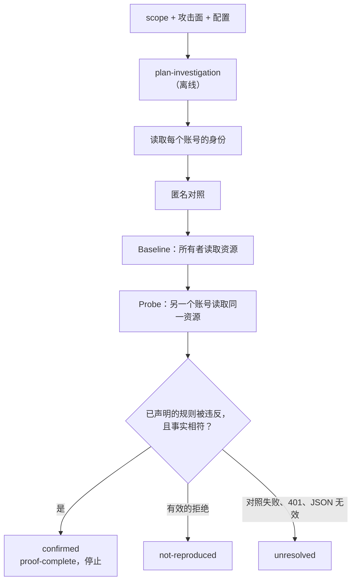

# 基于攻击面与语义证据的调查

[English](../INVESTIGATION.md) · [Español](../es/INVESTIGATION.md) · [Português (Brasil)](../pt-BR/INVESTIGATION.md) · **简体中文**

技能根据服务、文档和当前政策准备这些契约。操作者提供受控账号，以及无法通过公开渠道核实的业务规则。导入内容或书面规则并不能确立真实的授权。

## 工作流

```powershell
node dist/cli.js capabilities
node dist/cli.js import-surface --format openapi --input api.json --out surface.json
node dist/cli.js plan-investigation --scope scope.json --surface surface.json --profile profile.json --out runs/plan
node dist/cli.js investigate --scope scope.json --surface surface.json --profile profile.json --out runs/investigation
```



规划是离线的。`investigate` 发送 GET 请求来验证身份、运行 control/baseline/probe、评估事实并写出报告。它在第一次确认（`proof-complete`）时停止，其余假设保持待定。如果没有可表示的假设，它不发送请求，只写出覆盖情况和报告，并以退出码 3 结束。输出包括 scope、配置、计划、检查、带校验和及来源追溯的 `coverage.json`、带检查点的 `run/`、`semantic.json` 和 `report.md`。崩溃会保留 SQLite 预留。`resume-investigation <案例目录> --scope <规范范围> --out <新的 report.md>` 会验证定义和范围，重新评估保留的证据，并在已确认证明之后不再发送任何请求。不确定的预留不会被重复。其他终止性的停止，需要先审阅错误和预算，再新建案例。

## 配置

针对两个自有账号和私有文档，结构示例如下：

```json
{
  "schemaVersion": 1,
  "accounts": ["BBA_TOKEN_A", "BBA_TOKEN_B"],
  "identity": {
    "url": "https://service.example/me",
    "fact": "identity",
    "observe": [{ "name": "identity", "pointer": "/id" }]
  },
  "rules": [{
    "class": "bola",
    "origin": "https://service.example",
    "pathPrefix": "/documents",
    "protectedPointer": "/privateNotes",
    "subjectPointer": "/ownerId",
    "query": [],
    "policy": {
      "reference": "program private document rule",
      "boundary": "owner-only",
      "ownerFact": "owner"
    }
  }]
}
```

规则在精确范围内按来源和路径段前缀匹配；这并不会让每份文档都成为你的。资源必须属于受控账号。带查询的端点需要 `{ name, valueEnv: "BBA_INPUT_..." }` 以及针对这些名称的传输规则。数字/UUID 形式的历史 URL 可以变成模板，但不会按模板执行。可选的 `bindings: [{ entryId, url }]` 把一个条目绑定到具体的自有资源 URL，并依据模板和范围验证。未知的来源、不支持的方法、缺失的规则以及预算不足，都是明确的覆盖空白。

## 已确认的类别

| 类别 | 声明的政策 | 所需的服务器事实 |
|---|---|---|
| `bola` | `owner-only`、`ownerFact` | 资源所有者等于 baseline 的身份 |
| `bfla` | `role-private`、`roleFact`、`baselineRole`、`probeRole` | 服务器返回的不同角色与声明的角色一致 |
| `property-exposure` | 与 BFLA 相同 | 选定的私有属性越过了角色边界 |
| `tenant-isolation` | `tenant-private`、`tenantFact`、`resourceTenantFact` | 服务器返回的不同租户；资源的租户等于 baseline 的租户 |

对于角色，请从身份中投影该事实并使用 `subjectPointer: null`；对于租户，请同时投影身份和资源的租户。`protectedPointer` 标识被禁止受限账号读取的字段。各身份必须互不相同、类型相同，并且在比较之前就用后来用于 baseline/probe 的凭据获得。身份端点与资源端点共享同一来源。匿名对照必须被拒绝，baseline 必须返回有意义的受保护数据。probe 的确认要求同样的数据，以及归属/角色/租户的对照。请比较选定的字段，而不是可能因时间戳或 nonce 而不同的完整响应体。响应体哈希相同本身不能证明任何事情。probe 返回 401 是不确定的（会话过期）；在对照有效的情况下返回 403/404，则该次对比为 `not-reproduced`。字段缺失对该字段而言可能是负面结果；值不同或 JSON 无效则是不确定的。隐私以及不存在共享权限，仍是由操作者核实的前提条件。

## 事实与证据

`run` 步骤接受使用 RFC 6901 JSON Pointer 的 `observe: [{ name, pointer }]`。保存的事实包含名称、是否存在、类型、显著性和 SHA-256，并区分缺失、null 和不可读。原始值绝不保存。

```powershell
node dist/cli.js evaluate-semantic runs/investigation/run --checks runs/investigation/checks.json --out runs/result.md
node dist/cli.js evidence-view runs/investigation/run --query view.json
node dist/cli.js compare-runs --before runs/old --after runs/new --out runs/comparison.json
```

`view.json` 示例：`{ "kind": "summary", "offset": 0, "limit": 20 }`。分页请使用 `attempts` 或 `fields`，offset/limit 为 1–50，并可选 `stepId`。把 `revisionDigest` 作为 `expectedDigest` 传入，可拒绝已被改变的恢复修订。ID 为 `sessionId:stepId` 和 `sessionId:stepId:factName`。对比会关联两个修订，并区分定义、响应和事实的变化，但不对 bug 分类。凭据/输入的值无法比较；输入摘要绑定到会话。低熵值的哈希可能被猜出，且产物并不认证其操作者。

对于 `hunt`、`browser-check` 和 `browser-scenario`，`artifact.json` 把日志/结果与 scope/config 的摘要绑定。`artifact-view <目录> --query view.json` 会验证文件，并支持 `summary`、`events` 或 `fields`、分页、`eventType` 以及可选的 `expectedDigest`。事件 ID 是稳定的序号。旧的未封存或被中断的产物保留旧格式；请检查原始文件和预算，不要假定日志是完整的。

## 跨阶段预算

新的范围应携带 `budgetId`，例如 `dcs-public-pilot`。CLI/MCP 会在原始范围文件旁保留 `.bba-budgets/<budgetId>/`；在 run/resume、capture、hunt、investigate 和 browser-check 之间请复用其规范路径。

```powershell
node dist/cli.js inspect-budget .bba-budgets/dcs-public-pilot
```

计数、间隔和总时长在新的输出目录和进程崩溃后依然有效。该预算的授权和限制不能更改；各阶段可以缩小自己的攻击面。SQLite 锁防止各阶段并发。全局预留在发送前提交，如果结果不确定则视为已消耗。本地预留即使没有全局网络预留，也可能消耗本地预算。检查点会固定预算的位置并拒绝另一个账本。切勿通过删除/复制/重命名来重置消耗。没有 `budgetId` 的旧范围保持按次运行的语义。外部工具以及 BBA 之外的浏览需要单独核算。预算是一种操作性控制，不是许可的证明，也不能防止能够重写全部文件的人。
