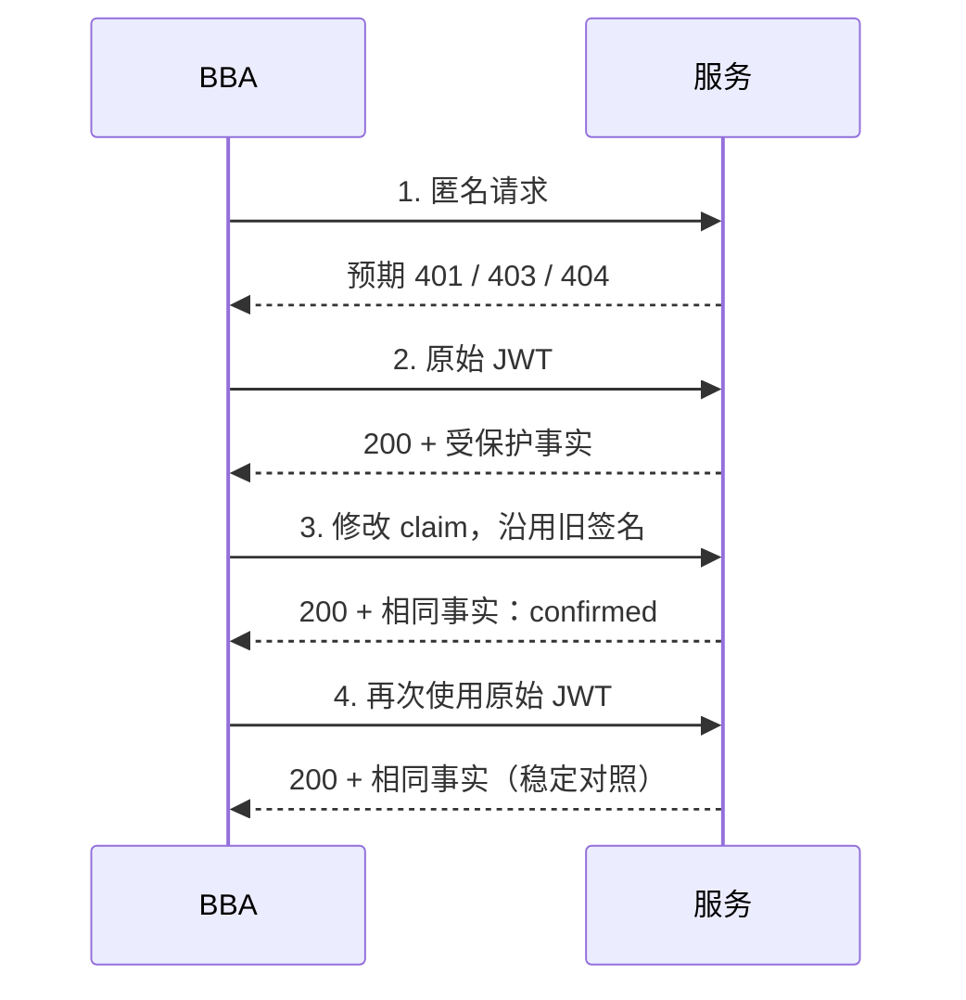

# 已签名 JWT 的完整性

[English](../JWT-INTEGRITY.md) · [Español](../es/JWT-INTEGRITY.md) · [Português (Brasil)](../pt-BR/JWT-INTEGRITY.md) · **简体中文**

此检查回答一个狭窄的问题：当来自你自有测试账号的 JWT 的载荷被修改，却**没有新的签名**时，服务是否仍然接受它？结果为阳性只能证明该路由接受了签名与内容不匹配的令牌。它不能证明可以访问其他身份、管理员权限或其他数据。

## 技能如何得出这个假设

已发表的 [Titan 案例](https://blog.faav.net/how-i-couldve-accessed-17-trillion-microsoft-records)结合了独立的 API、公开的 Swagger、存档的配置线索、claim 变异以及最小化的确认查询。其记录总数是根据元数据估算的，而不是数据转储。BBA 区分离线 OpenAPI/Swagger 中声明的路由、可能已过时的历史线索、范围内当前的观察，以及确认：匿名对照被拒绝、有效令牌稳定、被修改的令牌在你自己账号的受保护事实上被接受。VPN 前端并不能确立 API 的控制，也不授权被发现的主机。请针对每个主机、技术、方法和资源审阅政策。验证错误只是线索，本身绝不构成证明。

## 契约

使用一条已授权的路由和一个无害的查询，该查询只返回属于你测试账号的某个私有事实。请求体和机密来自环境变量：

```json
{
  "schemaVersion": 1,
  "policyReference": "program rule for owned account",
  "boundary": "jwt-signature-integrity",
  "url": "https://service.example/v2/Query",
  "request": { "method": "POST", "body": { "format": "json", "valueEnv": "BBA_BODY_QUERY" } },
  "credentialEnv": "BBA_TOKEN_OWNED",
  "proofPointer": "/result",
  "mutation": { "claim": "bba_probe", "mode": "add-canary" }
}
```

`replace` 也可以改为使用 `valueEnv: "BBA_INPUT_OWN_VALUE"` 修改现有 claim。只使用你控制的值和身份，不要使用猜测的用户或特权角色。`add-canary` 会添加一个由原始令牌派生的确定性 claim。两种模式都不会更改签名。起始令牌必须是已签名的、三段式紧凑 JWT；`alg: none` 作为输入会被拒绝。范围必须允许精确的 URL 和一条 JSON 格式的 POST `requestRule`。会改变状态的路由需要政策覆盖和一次性资源。`proofPointer` 选择一个无害的、非公开的 JSON 事实。只保存是否存在、类型、显著性和 SHA-256；低熵的值可能从哈希中被猜出。

## 运行与解读

```powershell
$env:BBA_TOKEN_OWNED = '<你自己测试账号的已签名 JWT>'
$env:BBA_BODY_QUERY = '{"query":"SELECT 1","tableName":"OwnedTestData","rowLimit":1}'
node dist/cli.js jwt-check --scope scope.json --config jwt-check.json --out runs/jwt-check
node dist/cli.js evaluate-jwt runs/jwt-check/run --config jwt-check.json --out runs/jwt-evaluation.json
```

这条 SQL 字符串演示的是针对**自有测试数据**的查询，并不意味着许可查询客户的表或生产环境元数据。请选择能展示受保护事实的最小请求；确认后即停止。引擎向同一个端点、使用同一个请求体恰好发送四个请求：匿名、原始 JWT、被修改的 JWT、再次使用原始 JWT。它不跟随重定向。共享预算会计入所有尝试和间隔；429/5xx 会中止流程。令牌只保留在内存中。输出保存带盐的令牌/变异绑定、不含凭据的计划、SQLite 检查点、`result.json` 和 `report.md` 草稿。`evaluate-jwt` 也可以生成 Markdown。



`confirmed` 要求匿名请求返回 401/403/404，两次使用有效令牌的 200 对照都带有相同且有意义的受保护事实，并且被修改的令牌返回带有该事实的 200。`not-reproduced` 表示这次变异被拒绝，而原始令牌仍然有效。对照缺失、响应不同或事实不可读，则为 `unresolved`。恢复需要**同一个原始令牌**、相同的范围、配置和规范预算：

```powershell
node dist/cli.js resume-jwt runs/jwt-check --scope scope.json --config jwt-check.json
```

不确定的预留绝不会被重复。如果响应在发送后丢失，那次对比仍然是不确定的；新建案例需要剩余预算和当前有效的授权。`evaluate-jwt` 是离线的。只报告所观察到的账号和路由。关于其他用户、角色或清单的结论，需要新的授权和新的对照。请如实记录汇总估算和有边界的样本；切勿为了夸大影响而枚举数据。
