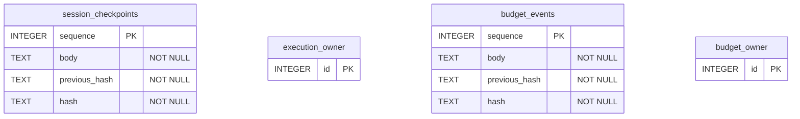

# 已实现的持久化

[English](../database.md) · [Español](../es/database.md) · [Português (Brasil)](../pt-BR/database.md) · **简体中文**

每次静态运行都有 `session.sqlite` 和 `execution-lock.sqlite`。每个共享预算都有 `budget.sqlite` 和 `lock.sqlite`。`owner` 表保持为空：由 `BEGIN IMMEDIATE` 事务持有进程锁，进程死亡时由操作系统释放。

图中的名称同时标识文件和表；它们不是额外的表。各文件之间没有 SQL 外键。事件和选定事实的引用（如 `sessionId:stepId`）存放在 `body` JSON 中，由应用负责验证。

`session_checkpoints` 表示 `session.sqlite/checkpoints`：不可变的 scope/plan 快照、尝试记录、输入/预算绑定以及脱敏后的 JSON 事实。`budget_events` 表示 `budget.sqlite/events`：初始的授权/限制摘要以及仅追加的 `reserve`/`finish` 事件。哈希链可以发现损坏，但既不能认证操作者，也不能阻止写入者替换整个历史。来源：`src/session.ts` 和 `src/budget.ts`。该模型已与 `CREATE TABLE` 语句以及锁、损坏和进程死亡测试对照检查。Mermaid 语法经过人工检查；本地未安装 Mermaid 解析器。
